# astro-voyager — интерактивный симулятор Вселенной

[](https://github.com/remageht/astro-voyager/actions/workflows/build.yml)
[](https://github.com/remageht/astro-voyager/releases)


Физически корректный 3D-симулятор космоса на C++17 и OpenGL: релятивистские черные дыры, квазары, пульсары, галактики, туманности и Солнечная система. Численное гравитационное линзирование лучей в реальном времени, свободный полет, межзвездный варп-привод, орбитальные станции и верфь кастомизации кораблей.

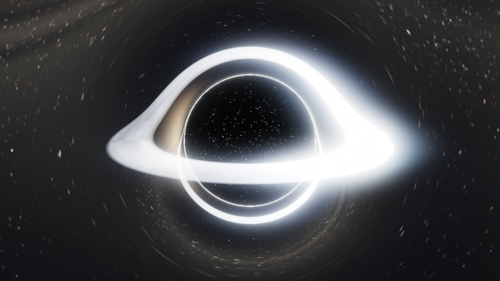
*Сверхмассивная чёрная дыра Sgr A*: численное RK4-линзирование в метрике Шварцшильда, тень горизонта, фотонное кольцо и тонкий аккреционный диск Новикова-Торна с доплеровским бимингом.*

---

## Флот кораблей и Верфь / Fleet & Shipyard

В игре доступно переключение между кораблями с кольцевым варп-приводом Алькубьерре и обычными досветовыми судами:

<table>
  <tr>
    <td width="50%" align="center">
      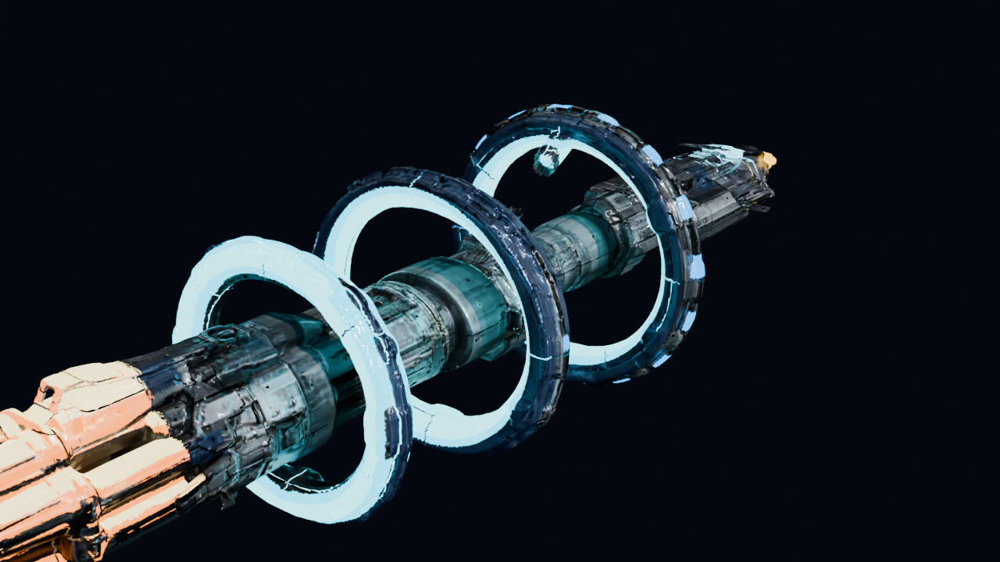<br>
      <b>Варп-корабль: Ring Ship IXS</b><br>
      <sub>Варп-катушки Алькубьерре, сверхсветовые прыжки (<code>X</code>, факторы 1–9), квантовое свечение плазменного ядра</sub>
    </td>
    <td width="50%" align="center">
      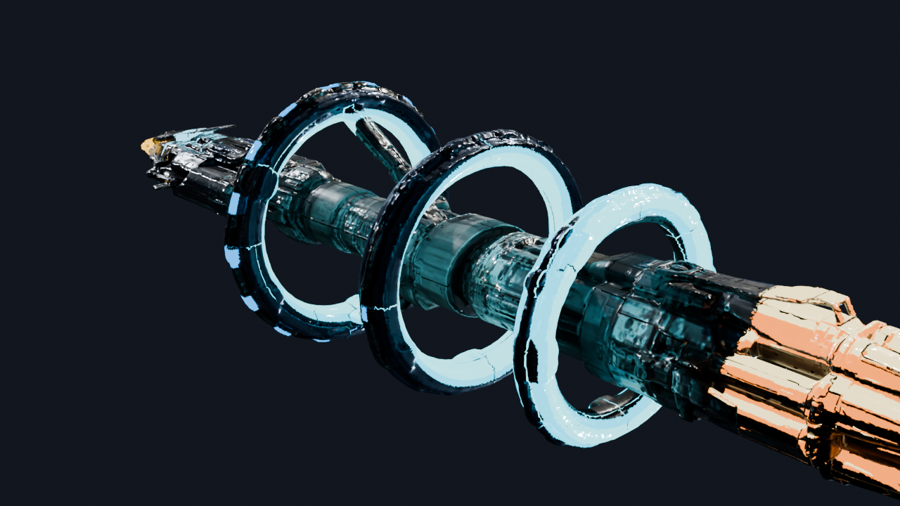<br>
      <b>Варп-корабль: Warp Cruiser</b><br>
      <sub>Флагман дальнего поиска, высокодетализированный PBR-корпус, IBL-освещение от окружения и навигационные огни</sub>
    </td>
  </tr>
  <tr>
    <td width="50%" align="center">
      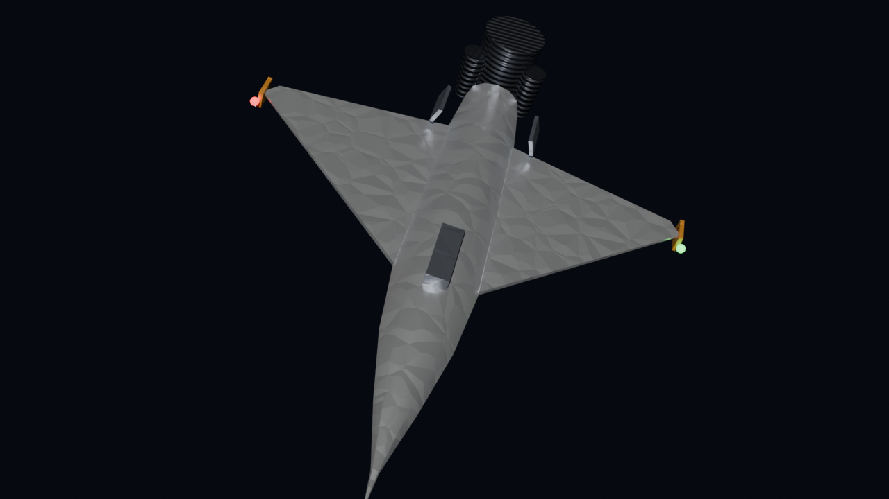<br>
      <b>Обычный корабль: Dart</b><br>
      <sub>Скоростной перехватчик/разведчик, стреловидное дельта-крыло, форсаж на обычном топливе (<code>Left Shift</code>)</sub>
    </td>
    <td width="50%" align="center">
      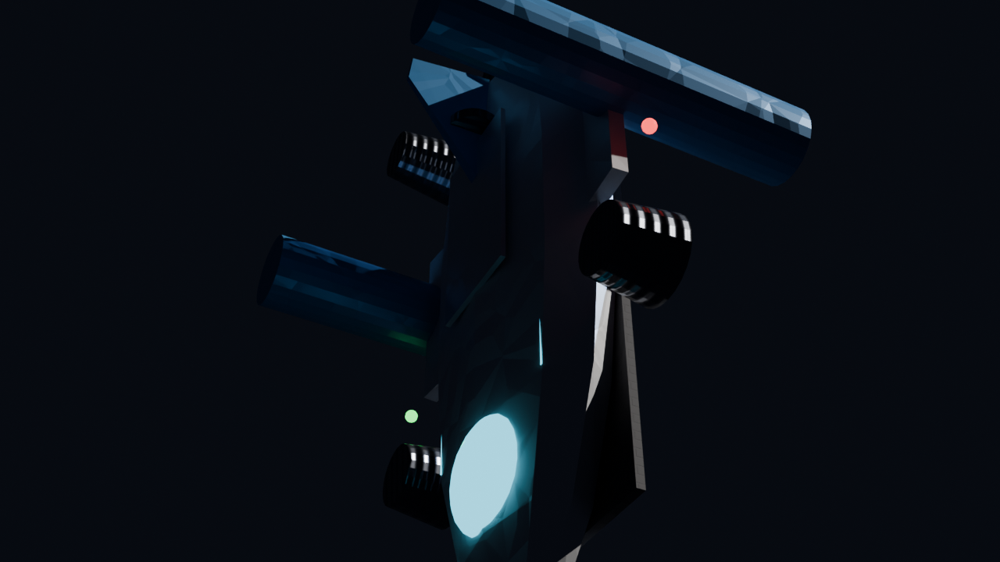<br>
      <b>Обычный корабль: Heavy Shuttle</b><br>
      <sub>Тяжёлый исследовательский челнок, сдвоенные мотогондолы, устойчивый досветовой атмосферно-орбитальный полёт</sub>
    </td>
  </tr>
</table>

### Орбитальные станции и кастомизация (Верфь `[K]`)

<p align="center">
  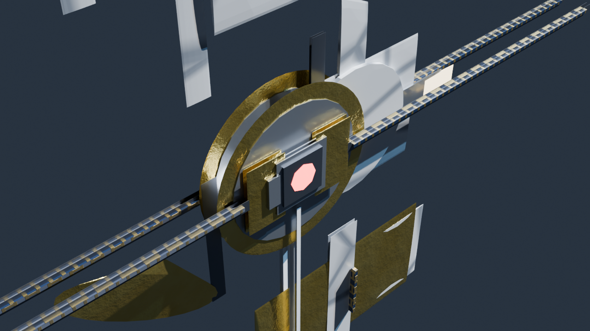
  <br>
  <sub><b>Орбитальная станция и космическая верфь</b>: высокодетализированная 3D-модель (типа МКС) с интегрированной фермой ITS, 8 массивами солнечных панелей, тепловыми радиаторами, модулями Destiny/Harmony/Kibo, куполом Cupola и стыковочными шлюзами.</sub>
</p>

- **Стыковка (`K`)**: При сближении с орбитальной станцией (< 4.5 ед.) нажмите `[K]` для захвата доком. Скорость гасится, щиты и баки топлива мгновенно восполняются до 100%, открывается интерфейс Верфи.
- **Ангар (Hangar)**: Мгновенное переключение активного корабля: Dart (0), Ring Ship (1), Shuttle (2), Warp Cruiser (3).
- **Покрасочный цех (Paint Shop)**: Индивидуальная настройка цветов обшивки (`Hull Tint`), полос (`Accent Tint`) и свечения плазмы (`Emissive Tint`) с быстрыми пресетами (*Quantum Cyan*, *Plasma Violet*, *Solar Gold*, *Void Stealth*).
- **Инженерные модификации**: Апгрейды форсажа маршевых двигателей (+45%), энергоемкости щитов (+37%) и гармоники варп-катушек (-36% расхода топлива на прыжок). Полное сохранение в профиль `save-sandbox.json`.
- **Анимации обратной связи (Feedback Animations)**: Двухфазная стыковка и отшвартовка манипуляторов с HUD-прогресс-баром заправки, плавный переход смены корабля в ангаре и световой ореол телепорта к станциям.
  *Two-phase docking/undocking sequences with refueling progress bars, smooth hull swap transitions in the shipyard hangar, and warp-in halo flashes for station jumps.*

---

## Галерея космических объектов

<table>
  <tr>
    <td width="50%">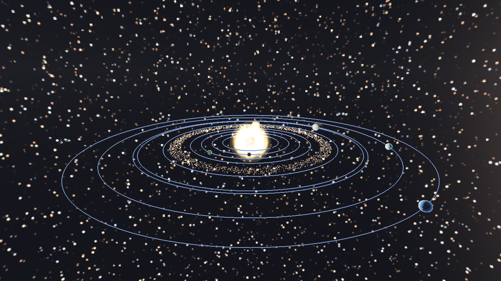<br><sub><b>Солнечная система</b>: 8 планет с осевым вращением, Сатурн с тенью колец и делением Кассини, спутники и пояс астероидов</sub></td>
    <td width="50%">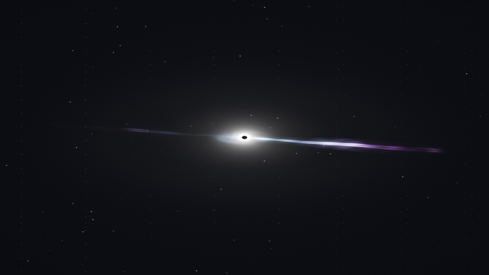<br><sub><b>Квазар 3C 273</b>: сверхъяркое ядро, релятивистские джеты с прецессией и вторичные гравитационные дуги</sub></td>
  </tr>
  <tr>
    <td>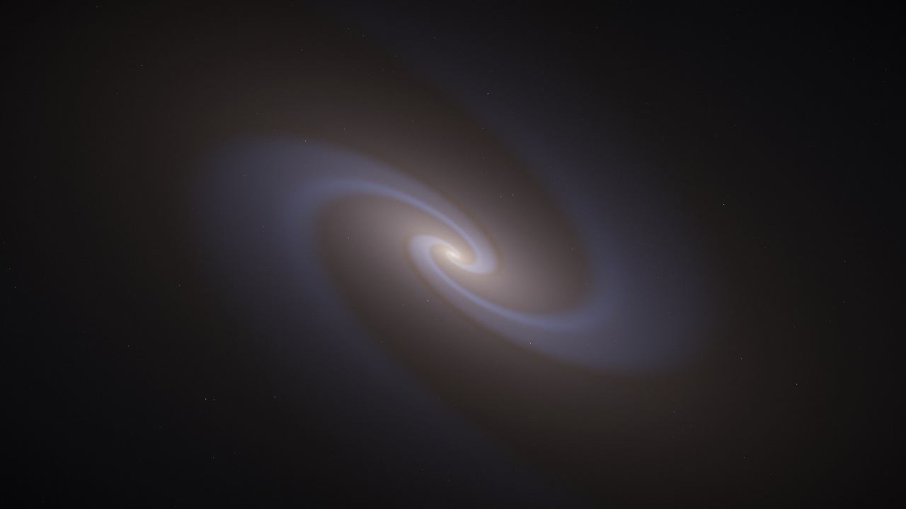<br><sub><b>Галактика Андромеда (M31)</b>: рукава из звёзд-частиц, динамический LOD-зум и приливной звездный поток</sub></td>
    <td>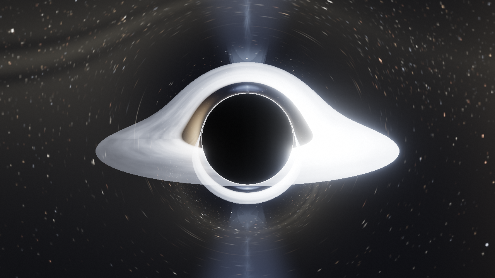<br><sub><b>M87*</b>: сверхмассивная чёрная дыра с синхротронным джетом и движущимися плазменными узлами HST-1</sub></td>
  </tr>
  <tr>
    <td>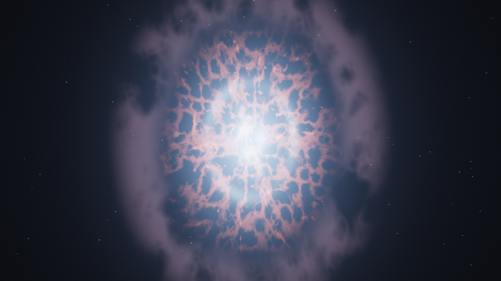<br><sub><b>Крабовидная туманность (M1)</b>: остаток сверхновой, пульсар со строб-маяком и волокна синхротронного излучения</sub></td>
    <td>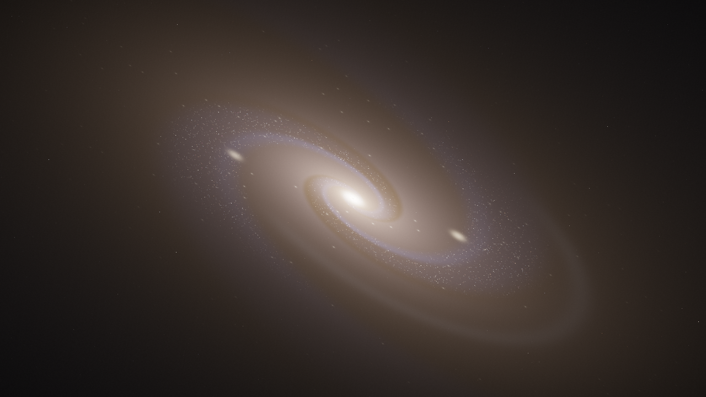<br><sub><b>Галактика Сомбреро (M104)</b>: массивная пылевая полоса вдоль экватора диска и сфероидальный балдж</sub></td>
  </tr>
</table>

Полный каталог включает 18 уникальных объектов: Sgr A*, 3C 273, M87*, OJ 287, Hyperdisk, M31, M51, M104, Млечный Путь, Скопление M13, Крабовидную туманность, пульсары Vela/Crab/B1913+16, магнетар SGR 1806-20, созвездия Орион и Большая Медведица (подробнее см. [`docs/CATALOG.md`](docs/CATALOG.md)).

---

## Управление / Controls

| Клавиша | Действие |
|---|---|
| **WASD** + мышь | Свободный полёт камеры и корабля |
| **Left Shift** | Форсажное ускорение на обычном топливе (досветовой режим) |
| **X** / **[** **]** | Варп-режим (факторы 1–9) и межзвёздные прыжки |
| **K** | Орбитальная верфь: стыковка со станцией / ангар флота / кастомизация / отстыковка |
| **Дабл-клик** | Автоматический подлёт к выбранному объекту |
| **/** | Быстрый нечёткий поиск по станциям каталога, `Enter` — мгновенный переход |
| **T** / Пробел | Кинематографический тур с автопилотом / пропуск сцены |
| **-** **=** / **P** | Ускорение времени (до 1000x) / Пауза |
| **M** | Звук: включение/отключение процедурного эмбиента и эффектов двигателей |
| **F5** / **F6** | Экспорт / импорт маршрута полёта |
| **F9** / **F10** | Быстрое сохранение / загрузка профиля (`save-sandbox.json`) |
| **H** / **F1** | Скрыть интерфейс / Экран помощи |

---

## Физическая модель и CPU-геометрия

1. **Гравитационное линзирование (GPU `shaders/bh.frag`)**: численное интегрирование нулевых геодезических в метрике Шварцшильда (RK4-трассировка лучей в реальном времени), моделирование тонкого аккреционного диска Новикова-Торна с учётом релятивистского биминга и гравитационного красного смещения. При разгоне включается релятивистский доплер-тинт и звёздная аберрация.
2. **Метрика Керра (CPU `src/Kerr.cpp`)**: точный расчёт нулевых геодезических вращающейся чёрной дыры со спином $|a| \le M$ без аппроксимаций (`./build/astro-voyager --demo-kerr`).
3. **Варп-геометрия (CPU `src/WarpMetric.h`, `src/WarpGeodesic.h`)**: универсальный 3+1 ADM-фреймворк, метрика пузыря Алькубьерре `AlcubierreMetric` с гладкой $\sigma$-стенкой, скаляр расширения Йорка $\theta_{\max}$ и генератор безопасных траекторий `skiffPath` с контролем инварианта времени $d\tau/dt \le 1$ (`./build/astro-voyager --demo-warp`). На GPU варп-прыжки выполняются в кинематографическом режиме с визуальным шейдерным коконом и линзой деформации пространства.

---

## Быстрый старт и сборка

### Сборка headless core (CLI-инструменты и физические тесты)
```bash
cmake -S . -B build -DCMAKE_BUILD_TYPE=Release
cmake --build build --config Release
./build/astro-voyager --list
./build/astro-voyager --demo-warp
./build/astro-voyager --demo-kerr
```

### Запуск полного 3D-приложения (OpenGL 3.3 Core)
Для сборки графического окна требуется опция `ASTROVOYAGER_ENABLE_GL=ON` (подробнее см. [`docs/BUILD.md`](docs/BUILD.md)):
```bash
cmake -S . -B build-gl -DASTROVOYAGER_ENABLE_GL=ON -DCMAKE_BUILD_TYPE=Release
cmake --build build-gl --config Release
./build-gl/Release/astro-voyager.exe --gl
```

---

## Тестирование и валидация

```powershell
powershell -ExecutionPolicy Bypass -File tests/test_static_checks.ps1
ctest --test-dir build -C Release
```

CI автоматически проверяет сборку на Windows, Ubuntu Linux и macOS, собирает Linux AppImage и портативные архивы с хэш-суммами `CHECKSUMS.txt`.

> [!NOTE]
> **Windows SmartScreen**: Неподписанные портативные exe-файлы могут вызывать предупреждение SmartScreen. Нажмите «Подробнее → Выполнить в любом случае» или в свойствах файла отметьте галочку «Разблокировать». Хэши SHA-256 всегда приведены в файле релиза (подробнее см. [`docs/RELEASE.md`](docs/RELEASE.md)).
