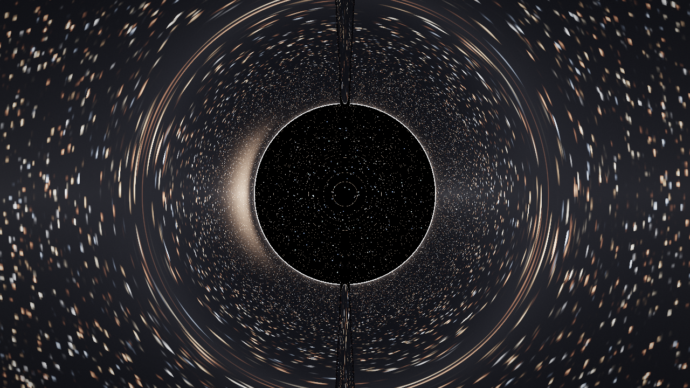

# astro-voyager — путешественник по Вселенной

[](https://github.com/remageht/astro-voyager/actions/workflows/build.yml)
[](https://github.com/remageht/astro-voyager/releases)


### 3D-приложение: чёрные дыры, квазары, галактики, планеты и созвездия


*Sgr A*: численное линзирование в метрике Шварцшильда — тень, фотонное кольцо, тонкий диск*

Идея наследована от `RuCatGH/blackHole`: не картинка, а численная физика
линзирования в метрике Шварцшильда (RK4-геодезические в шейдере).
`astro-voyager` расширяет её до путешественника: свободный полёт WASD,
**варп-двигатель (W)** с факторами 1–9 и прыжками между станциями,
**кинотур (T)** с автопилотом, телепорт по каталогу, дабл-клик — подлёт к
объекту, ускорение времени до 1000x, осевое вращение планет, F5/F6 —
экспорт/импорт маршрута.

Название: `astro-voyager` — коротко, GitHub/Docker-friendly, покрывает все типы
объектов (не только дыру). Отвергнуты: `event-horizon` (только ЧД),
`cosmo-traveler` (длинно), `starhopper` (ассоциация с игрой).

## Станции каталога

| id | Тип | Название | Что рендерит |
|----|-----|----------|--------------|
| `sgra` | `black_hole` | Sgr A* | Численный raytracing нулевых геодезических в метрике Шварцшильда (RK4, $R_s=1.0$, захват $r \le 1.001 R_s$, уход $r \ge R_{\text{shell}}$) |
| `qso-3c273` | `quasar` | 3C 273 | Процедурный raymarching квазара: светящееся ядро, аккреционный диск и полярные релятивистские джеты |
| `ori` | `constellation` | Orion | Созвездие Ориона: 16 вершин, 9 отрезков (`GL_LINES`) связей пояса, Бетельгейзе и Ригеля + звезды Hipparcos (`GL_POINTS`) |
| `uma` | `constellation` | Ursa Major | Большая Медведица: астеризм Большого Ковша (14 вершин, 7 отрезков) с центрированной проекцией |
| `m31` | `galaxy` | Andromeda (M31) | Спиральная галактика с LOD-зумом: издалека рукава из звёзд-частиц, вблизи объёмное поле + именованные звёзды (AE/AF/S And, M31N), приливной поток |
| `m1` | `nebula` | Crab Nebula (M1) | Остаток сверхновой: пульсар-маяк со стробом, дрейфующие wisps-дуги, синхротронные волокна |
| `sol` | `solar_system` | Solar System | Солнце с кипящей грануляцией и короной + 8 вращающихся планет (БКП Юпитера, деление Кассини, два хвоста Галлеи) |
| `m87` | `black_hole` | M87* | Гигантская ЧД с релятивистским джетом и движущимися узлами HST-1 |

Фон всех станций: процедурный генератор звездного неба и Млечного Пути с автозагрузкой локального HDR (`starmap_2020_4k_gal.hdr`, в git не входит).

## Управление

| Клавиша | Действие |
|---------|----------|
| WASD + мышь | Свободный полёт |
| Дабл-клик | Подлёт к объекту |
| `/` | Поиск станций (нечёткий), Enter — телепорт |
| `W`, `[` `]` | Варп-режим, факторы 1–9, прыжки между станциями |
| `T` / Пробел / ESC | Кинотур / пропуск / выход |
| `-` `=` | Темп времени (до 1000x), `P` — пауза |
| `H` / `F1` | Скрыть панель / помощь |
| F5 / F6 | Экспорт / импорт маршрута |

## Физическая модель и ограничения (Limits & Assumptions)

1. **Метрика Шварцшильда**: статическая, незаряженная и сферически-симметричная черная дыра ($M > 0$, $a = 0$, $Q = 0$).
2. **Лимит: метрика Керра в рендерере отсутствует (No Kerr metric in renderer)**. Несмотря на наличие спина у реального Sagittarius A*, в шейдерном рендерере (`bh.frag`) сознательно используется геометрия Шварцшильда. Эффекты эргосферы, увлечения инерциальных систем отсчета (frame-dragging / Lense-Thirring) и спинового расщепления фотонных орбит в реальном времени опущены ради стабильности и производительности GPU. При этом физика нулевых геодезических Керра со спином $|a| \le M$ реализована в виде отдельного CPU-модуля `src/Kerr.cpp` с аналитической валидацией (`--demo-kerr`) без визуализации.
3. **Чистое гравитационное линзирование в `bh.frag`**: шейдер `bh.frag` рассчитывает искривление световых лучей от фонового скайбокса. Синтетический светящийся диск и релятивистский доплеровский сдвиг в `bh.frag` отсутствуют; физика аккреционного диска и джетов смоделирована отдельно на станции квазара `3C 273`.
4. **Критерии останова лучей**:
   - Поглощение горизонтом событий: $r \le R_s \times 1.001$ (черный цвет).
   - Выход на асимптотическую бесконечность: $r \ge R_{\text{shell}}$ (выборка цвета из cubemap).
   - Ограничение камеры: радиус камеры аппаратно ограничен $R \ge 1.05 R_s$, исключая падение наблюдателя под горизонт событий.
5. **Пресеты производительности (Low / Med / Ultra)**:
   - **Low**: $R_{\text{shell}}=20.0$, $h=0.08$, maxSteps=300 (для слабых/интегрированных GPU).
   - **Med** (дефолт): $R_{\text{shell}}=30.0$, $h=0.05$, maxSteps=600 (сбалансированный режим).
   - **Ultra**: $R_{\text{shell}}=45.0$, $h=0.025$, maxSteps=1200 (высокая детализация фотонной сферы).

## Быстрый старт (headless core, без GPU)

```bash
cmake -S . -B build -DCMAKE_BUILD_TYPE=Release
cmake --build build --config Release
./build/astro-voyager --list
./build/astro-voyager --info sgra
./build/astro-voyager --demo-geodesic
./build/astro-voyager --test-interaction
# Windows: .\build\Release\astro-voyager.exe --list
```

Полный 3D-рендер (OpenGL) — опция `ASTROVOYAGER_ENABLE_GL=ON`, требует
GLFW/GLEW/GLM/ImGui локально, см. `docs/BUILD.md`. В CI собирается только core.

## Структура

```
astro-voyager/
  CMakeLists.txt
  src/            # Catalog, Camera, Geodesic, Interaction, SceneManager, AppGL
  shaders/        # quad.vert, bh.frag, quasar.frag, lines.vert, galaxy.frag, nebula.frag
  res/catalog.json# каталог станций (зеркало Catalog.cpp)
  docs/           # ARCHITECTURE, BUILD, CATALOG, ROADMAP, RELEASE, screens
  tests/          # test_static_checks.ps1, test_interaction.cpp
  .github/workflows/build.yml
  Dockerfile      # reproducible build
  .env.example    # ASTRO_* переменные
```

HDR-ассеты положить вручную:
```
res/textures/starmap_2020_4k_gal.hdr  # любой equirect HDR, в git не входит
```

## Прод-гейты

```powershell
powershell -ExecutionPolicy Bypass -File tests/test_static_checks.ps1
```

CI: сборка Windows + Linux, static checks, сборка Docker-образа.
Контракт каталога: `docs/CATALOG.md`. Архитектура: `docs/ARCHITECTURE.md`. Релиз: `docs/RELEASE.md`.

## Версии

См. `CHANGELOG.md`. Скриншоты станций — в `docs/screens/` (референсы
прод-гейта: каждый коммит с визуальными изменениями обязан их переснять).
