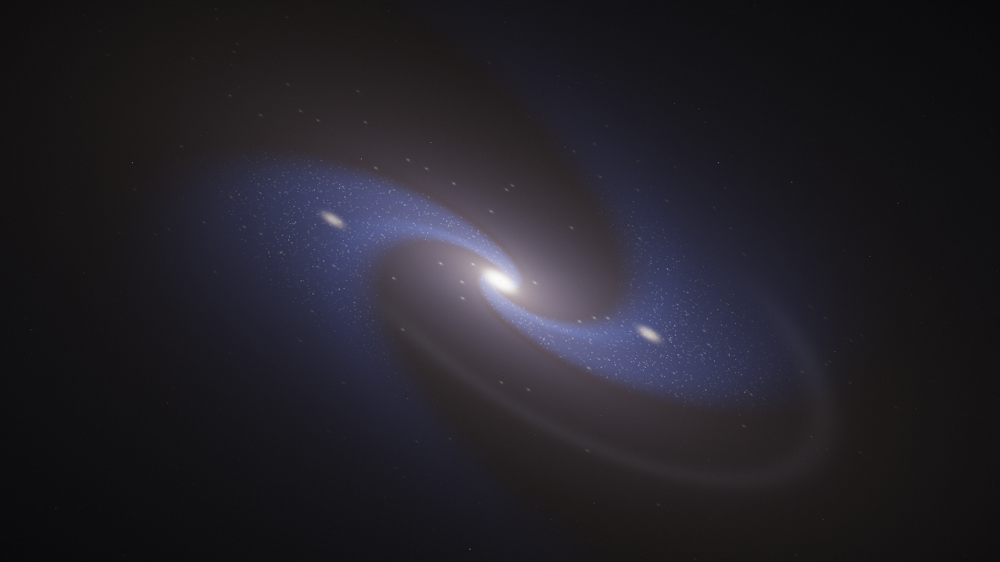
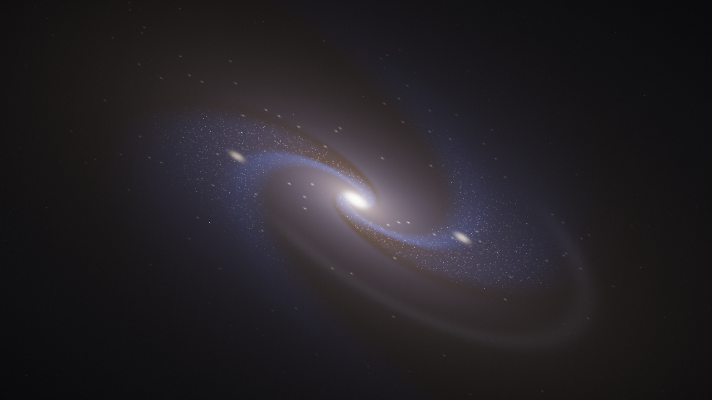
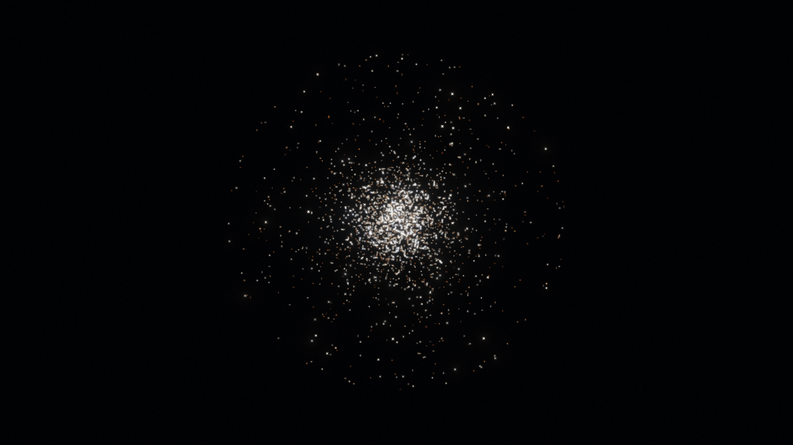
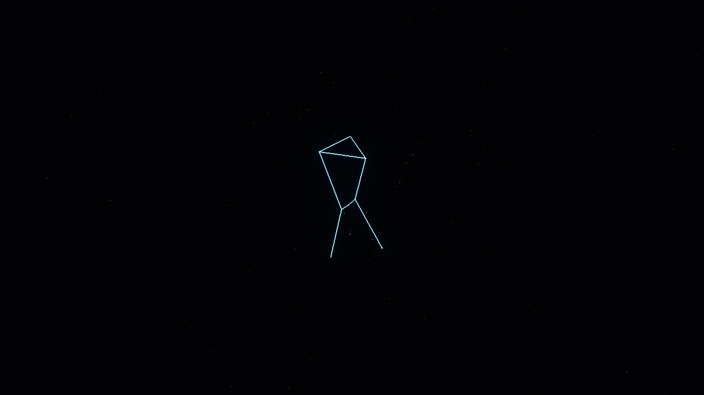
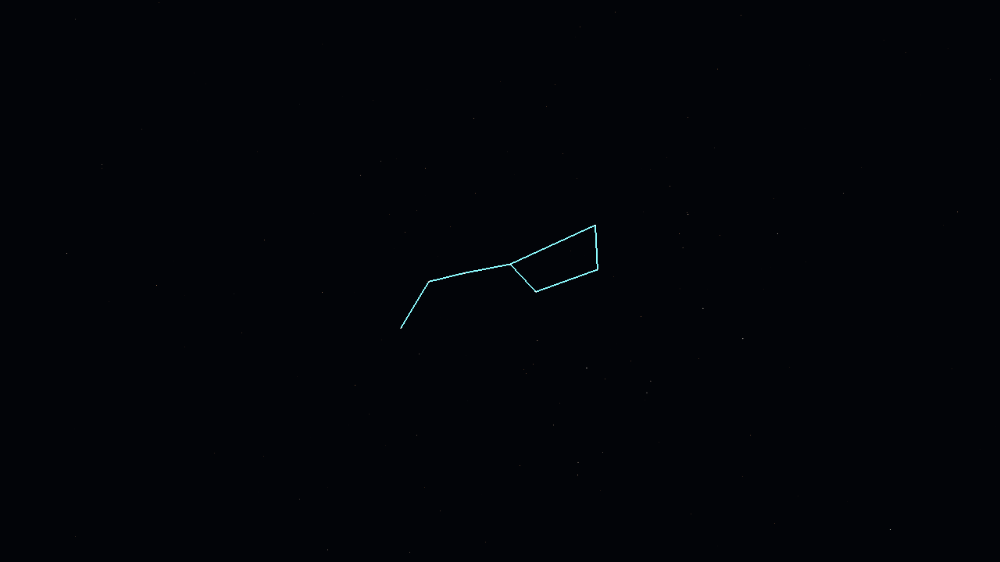
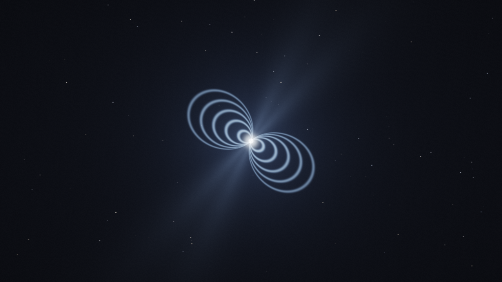
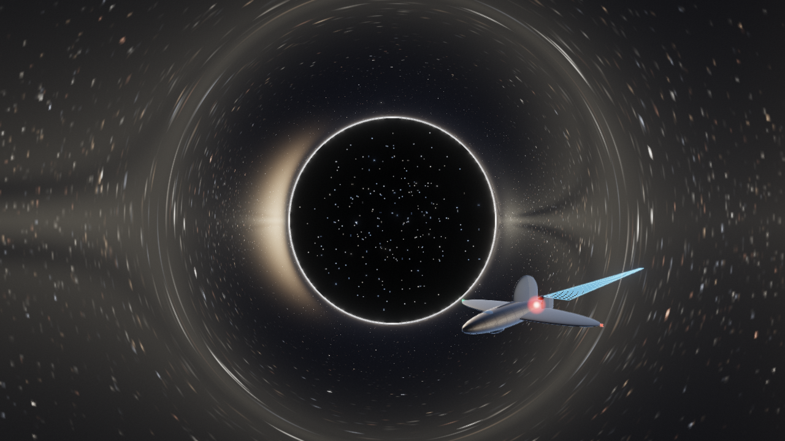

# astro-voyager — путешественник по Вселенной

[](https://github.com/remageht/astro-voyager/actions/workflows/build.yml)
[](https://github.com/remageht/astro-voyager/releases)


### 3D-приложение: чёрные дыры, квазары, галактики, планеты и созвездия


*Sgr A*: численное линзирование в метрике Шварцшильда — тень, фотонное кольцо, тонкий диск*

Идея наследована от `RuCatGH/blackHole`: не картинка, а численная физика
линзирования в метрике Шварцшильда (RK4-геодезические в шейдере).
`astro-voyager` расширяет её до путешественника: свободный полёт WASD,
**варп-двигатель (X)** с факторами 1–9 и кинематографичными прыжками между
станциями, **кинотур (T)** с автопилотом, телепорт по каталогу, дабл-клик —
подлёт к объекту, ускорение времени до 1000x, осевое вращение планет,
F5/F6 — экспорт/импорт маршрута. Пост-процессинг: HDR-композит через
FBO с **bloom** (5 уровней яркости) и **релятивистским сдвигом света**
(доплер-тинт и аберрация звёзд при быстром полёте).

**Редактор объектов (v3.2.0)**: палитра из 5 типов (камень, скалистая
планета, луна, газовый гигант, звезда) — размер, два цвета, seed, кольца;
добавление перед камерой, выбор кликом и живое редактирование, удаление,
очистка (станция `sol`). Поверхности планет получают дополнительную
детализацию при приближении камеры.

Название: `astro-voyager` — коротко, GitHub/Docker-friendly, покрывает все типы
объектов (не только дыру). Отвергнуты: `event-horizon` (только ЧД),
`cosmo-traveler` (длинно), `starhopper` (ассоциация с игрой).

## Галерея объектов

<table>
  <tr>
    <td width="50%"><br><sub><b>Солнечная система</b>: Сатурн с делением Кассини и тенью колец, Большое красное пятно Юпитера, пояс астероидов</sub></td>
    <td width="50%"><br><sub><b>Квазар 3C 273</b>: светящееся ядро, аккреционный диск, полярные релятивистские джеты</sub></td>
  </tr>
  <tr>
    <td><br><sub><b>Andromeda (M31)</b>: рукава из звёзд-частиц, LOD-зум, приливной поток</sub></td>
    <td><br><sub><b>M87*</b>: гигантская ЧД с релятивистским джетом и движущимися узлами HST-1</sub></td>
  </tr>
  <tr>
    <td><br><sub><b>Whirlpool (M51)</b>: широкие рукава, яркий балдж и компаньон NGC 5195</sub></td>
    <td><br><sub><b>Sombrero (M104)</b>: тёмная пылевая полоса вдоль диска и крупный балдж</sub></td>
  </tr>
  <tr>
    <td><br><sub><b>Milky Way</b>: наша Галактика снаружи — найдите Солнце и подлетите ближе 3 единиц</sub></td>
    <td><br><sub><b>Crab Nebula (M1)</b>: пульсар-маяк со стробом, wisps-дуги, синхротронные волокна</sub></td>
  </tr>
  <tr>
    <td><br><sub><b>Hercules Cluster (M13)</b>: тысячи древних звёзд — между ними можно летать</sub></td>
    <td><br><sub><b>Orion</b>: 16 вершин, пояс из 9 отрезков, Бетельгейзе и Ригель + звёзды Hipparcos</sub></td>
  </tr>
  <tr>
    <td><br><sub><b>Ursa Major</b>: астеризм Большого Ковша с центрированной проекцией</sub></td>
    <td><br><sub><b>Vela Pulsar</b>: наклонный дипольный маяк, горячие полюса, дуги магнитосферы, тик 89 мс</sub></td>
  </tr>
  <tr>
    <td colspan="2"><br><sub><b>Warp-корабль игрока</b>: PBR-материалы, IBL из скайбокса станции, ключевой свет от доминирующего источника (Sgr A*)</sub></td>
  </tr>
</table>

## Станции каталога

| id | Тип | Название | Что рендерит |
|----|-----|----------|--------------|
| `sgra` | `black_hole` | Sgr A* | Численный raytracing нулевых геодезических в метрике Шварцшильда (RK4, $R_s=1.0$, захват $r \le 1.001 R_s$, уход $r \ge R_{\text{shell}}$) |
| `qso-3c273` | `quasar` | 3C 273 | Процедурный raymarching квазара: светящееся ядро, аккреционный диск и полярные релятивистские джеты |
| `ori` | `constellation` | Orion | Созвездие Ориона: 16 вершин, 9 отрезков (`GL_LINES`) связей пояса, Бетельгейзе и Ригеля + звезды Hipparcos (`GL_POINTS`) |
| `uma` | `constellation` | Ursa Major | Большая Медведица: астеризм Большого Ковша (14 вершин, 7 отрезков) с центрированной проекцией |
| `m31` | `galaxy` | Andromeda (M31) | Спиральная галактика с LOD-зумом: издалека рукава из звёзд-частиц, вблизи объёмное поле + именованные звёзды (AE/AF/S And, M31N), приливной поток |
| `m1` | `nebula` | Crab Nebula (M1) | Остаток сверхновой: пульсар-маяк со стробом, дрейфующие wisps-дуги, синхротронные волокна |
| `sol` | `solar_system` | Solar System | Солнце с кипящей грануляцией и короной + 8 вращающихся планет и Плутон (БКП Юпитера, деление Кассини, два хвоста Галлеи); галилеевы луны и Титан, тень колец Сатурна, кольца Урана, пояс астероидов |
| `m87` | `black_hole` | M87* | Гигантская ЧД с релятивистским джетом и движущимися узлами HST-1 |
| `m51` | `galaxy` | Whirlpool (M51) | Спиральная галактика с широкими рукавами, ярким балджем и компаньоном NGC 5195 |
| `m104` | `galaxy` | Sombrero (M104) | Галактика-сомбреро: тёмная пылевая полоса вдоль диска и крупный яркий балдж |
| `psr-vela` | `pulsar` | Vela Pulsar | Молодая нейтронная звезда: наклонный дипольный маяк, горячие полюса, дуги магнитосферы, тик 89 мс |
| `psr-crab` | `pulsar` | Crab Pulsar | Пульсар Крабовидной туманности (33 мс): быстрый маяк, пара к станции `m1` |
| `sgr-1806` | `pulsar` | SGR 1806-20 | Магнетар: поле 1e15 Гс, огромные дуги, янтарное гало вспышек |
| `psr-b1913` | `pulsar` | PSR B1913+16 | Двойной пульсар Халса-Тейлора: распад орбиты доказал гравитационные волны |
| `mw` | `galaxy` | Milky Way | Наша Галактика снаружи: найдите Солнце и подлетите ближе 3 единиц — автопрыжок домой в `sol` |
| `m13` | `star_cluster` | Hercules Cluster (M13) | Шаровое скопление: тысячи древних звёзд, можно летать между ними |

Фон всех станций: процедурный генератор звездного неба и Млечного Пути с автозагрузкой локального HDR (`starmap_2020_4k_gal.hdr`, в git не входит).

## Управление

| Клавиша | Действие |
|---------|----------|
| WASD + мышь | Свободный полёт |
| Дабл-клик | Подлёт к объекту |
| `/` | Поиск станций (нечёткий), Enter — телепорт |
| `X`, `[` `]` | Варп-режим, факторы 1–9, прыжки между станциями |
| `T` / Пробел / ESC | Кинотур / пропуск / выход |
| `-` `=` | Темп времени (до 1000x), `P` — пауза |
| `M` | Звук: мьют (процедурный эмбиент + эффекты, громкость в панели) |
| `H` / `F1` | Скрыть панель / помощь |
| F5 / F6 | Экспорт / импорт маршрута |
| F9 / F10 | Быстрое сохранение / загрузка профиля (автосейв при выходе) |

## Сохранения (v3.4.0)

Профиль игрока — JSON в пользовательской директории: Windows
`%APPDATA%\astro-voyager\`, Linux `~/.config/astro-voyager/`, macOS
`~/Library/Application Support/astro-voyager/`. Файлы: `save-sandbox.json`
(прогресс, ачивки, история маршрута, объекты редактора, сессия — станция,
камера, время, топливо/щиты) и `settings.json` (пресет производительности,
звук, вид камеры). F9/F10 — быстрое сохранение/загрузка, кнопки Save/Load
в меню, автосейв при выходе; слот сюжетного режима `save-adventure.json`
зарезервирован под v4.0. Файлы человекочитаемые (pretty JSON) — можно
править руками; схема версионируется, неизвестные поля игнорируются.

## Физическая модель и ограничения (Limits & Assumptions)

1. **Метрика Шварцшильда**: статическая, незаряженная и сферически-симметричная черная дыра ($M > 0$, $a = 0$, $Q = 0$).
2. **Лимит: метрика Керра в рендерере отсутствует (No Kerr metric in renderer)**. Несмотря на наличие спина у реального Sagittarius A*, в шейдерном рендерере (`bh.frag`) сознательно используется геометрия Шварцшильда. Эффекты эргосферы, увлечения инерциальных систем отсчета (frame-dragging / Lense-Thirring) и спинового расщепления фотонных орбит в реальном времени опущены ради стабильности и производительности GPU. При этом физика нулевых геодезических Керра со спином $|a| \le M$ реализована в виде отдельного CPU-модуля `src/Kerr.cpp` с аналитической валидацией (`--demo-kerr`) без визуализации.
3. **Гравитационное линзирование + аккреционный диск в `bh.frag`**: шейдер `bh.frag` рассчитывает искривление световых лучей (RK4-геодезические) и рендерит физически честный тонкий диск Новикова-Торна с фактором Бардена (доплеровский биминг, гравитационный красный сдвиг наблюдателя). Джеты и вторичные эффекты квазара смоделированы отдельно на станции `3C 273`. При быстром полёте (варп, прыжок) включается **релятивистский сдвиг света**: доплер-тинт (вперёд синий, назад красный) и аберрация звёзд к направлению движения.
4. **Критерии останова лучей**:
   - Поглощение горизонтом событий: $r \le R_s \times 1.001$ (черный цвет).
   - Выход на асимптотическую бесконечность: $r \ge R_{\text{shell}}$ (выборка цвета из cubemap).
   - Ограничение камеры: радиус камеры аппаратно ограничен $R \ge 1.05 R_s$, исключая падение наблюдателя под горизонт событий.
5. **Пресеты производительности (Low / Med / Ultra)**:
   - **Low**: $R_{\text{shell}}=20.0$, $h=0.08$, maxSteps=300 (для слабых/интегрированных GPU).
   - **Med** (дефолт): $R_{\text{shell}}=30.0$, $h=0.05$, maxSteps=600 (сбалансированный режим).
   - **Ultra**: $R_{\text{shell}}=45.0$, $h=0.025$, maxSteps=1200 (высокая детализация фотонной сферы).

## Быстрый старт (headless core, без GPU)

```bash
cmake -S . -B build -DCMAKE_BUILD_TYPE=Release
cmake --build build --config Release
./build/astro-voyager --list
./build/astro-voyager --info sgra
./build/astro-voyager --demo-geodesic
./build/astro-voyager --test-interaction
# Windows: .\build\Release\astro-voyager.exe --list
```

Полный 3D-рендер (OpenGL) — опция `ASTROVOYAGER_ENABLE_GL=ON`, требует
GLFW/GLM/ImGui локально, см. `docs/BUILD.md`. macOS: системный OpenGL 3.3
(без GLEW — `src/GLCompat.h`), сборка `bash packaging/fetch-gl-deps.sh` +
`-DASTROVOYAGER_ENABLE_GL=ON`. CI собирает core на Windows/Linux/macOS,
полный GL — Linux AppImage и macOS (arm64).

## Структура

```
astro-voyager/
  CMakeLists.txt
  src/            # Catalog, Camera, Geodesic, Interaction, SceneManager, PostFX, AppGL, SaveGame
  shaders/        # quad.vert, bh.frag, quasar.frag, lines.vert, galaxy.frag,
                  # nebula.frag, sky.frag, post_comp/bright/blur.frag, warp.frag, ...
  res/catalog.json# каталог станций (зеркало Catalog.cpp)
  docs/           # ARCHITECTURE, BUILD, CATALOG, ROADMAP, RELEASE, screens
  tests/          # test_static_checks.ps1, test_interaction.cpp, test_save.cpp, test_doppler_side.ps1
  .github/workflows/build.yml
  Dockerfile      # reproducible build
  .env.example    # ASTRO_* переменные
```

HDR-ассеты положить вручную:
```
res/textures/starmap_2020_4k_gal.hdr  # любой equirect HDR, в git не входит
```

## Прод-гейты

```powershell
powershell -ExecutionPolicy Bypass -File tests/test_static_checks.ps1
```

CI: сборка Windows/Linux/macOS, static checks, AppImage, macOS-архив, Docker-образ.
Контракт каталога: `docs/CATALOG.md`. Архитектура: `docs/ARCHITECTURE.md`. Релиз: `docs/RELEASE.md`.

## Версии

См. `CHANGELOG.md`. Скриншоты станций — в `docs/screens/` (референсы
прод-гейта: каждый коммит с визуальными изменениями обязан их переснять).

## Антивирус: ложные срабатывания (v3.8.1)

Windows-сборка распространяется неподписанной, поэтому отдельные
генерик-эвристики AV (например, MaxSecure `Trojan.Malware.300983.susgen`
и SecureAge `Malicious` на VirusTotal у v3.8.0: 2/71) помечают exe
эвристически. Microsoft Defender, Kaspersky, ESET, BitDefender и ещё ~67
движков — чисто.

Что сделать, если сработало:
- сверьте SHA256 в `CHECKSUMS.txt` внутри zip с хэшами на странице релиза —
  они обязаны совпадать;
- добавьте исключение или восстановите из карантина (Windows Security →
  Protection history), либо сообщите о ложном срабатывании вендору AV или
  через VirusTotal («Report false positive»);
- внутри zip лежит `win-av-readme.txt` с этой памяткой (EN);
- планируются подписанные релизы (code signing), подробнее — `docs/RELEASE.md`.
