# astro-voyager — интерактивный симулятор Вселенной

[](https://github.com/remageht/astro-voyager/actions/workflows/build.yml)
[](https://github.com/remageht/astro-voyager/releases)


Физически корректный 3D-симулятор космоса на C++17 и OpenGL: релятивистские черные дыры, квазары, пульсары, галактики, туманности и Солнечная система. Численное гравитационное линзирование лучей в реальном времени, свободный полет, межзвездный варп-привод, орбитальные станции и верфь кастомизации кораблей.

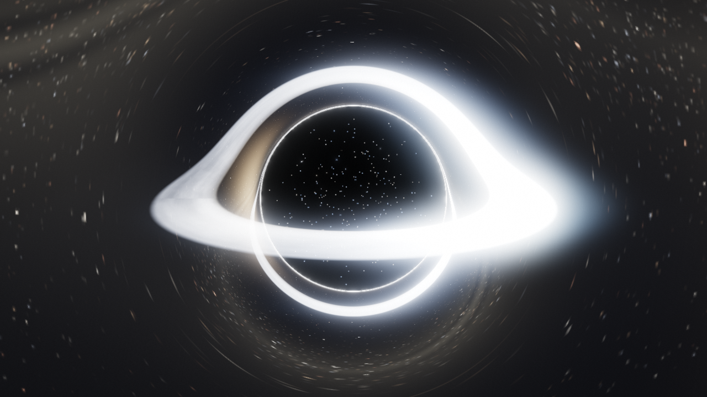
*Сверхмассивная чёрная дыра Sgr A*: численное RK4-линзирование в метрике Шварцшильда, тень горизонта, фотонное кольцо и тонкий аккреционный диск Новикова-Торна с доплеровским бимингом.*

---

## Приключение и песочница / Adventure & Sandbox

- **Новая игра · Adventure**: сюжетный слот с прологом Егорки (иллюстрированные слайды), отдельным профилем `save-adventure.json` и высадкой в Солнечной системе.
- **Кампания из 7 глав**: Дом (Солнечная система) → Последний караул (Crew Dragon и «Союз-МС» на орбите Земли) → Сердце Галактики (Sgr A*) → Монстр с джетом (M87*) → Маяк ранней Вселенной (3C 273) → Новые кандидаты (M13) → Финал Мультивселенной. Итоги глав комментирует пилот Мия Сато и Егорка-6.
- **Шесть концовок Мультивселенной**: у скопления M13 экипажу предстоит сделать судьбоносный выбор, определяющий будущее человечества:
  1. *Новый Дом* (Мия Сато) — основание колонии среди старых звёзд M13.
  2. *Далёкий Горизонт* (Мия Сато) — прыжок за край Галактики в межгалактическую бесконечность.
  3. *Возрождение Солнца* (д-р Елена Ростова) — квантовая инжекция антиматерии в солнечное ядро и спасение Земли.
  4. *Замкнутая Петля Времени* (Егорка) — погружение в Sgr A*, временной разлом над Сеной в Париже 2026 года и передача кулона.
  5. *Орбитальная Цитадель «Астро-Ковчег»* (ком. Марк Хейл) — автономный мобильный мегаполис человечества среди звёзд.
  6. *Гиперпрорыв Мультивселенной* (Егорка-6) — оверклок варп-ядра до 135% с фазовым кристаллом и прорыв сквозь сингулярность в параллельные миры.
  Каждая концовка сопровождается эксклюзивной широкоформатной кинематографичной 16:9 иллюстрацией, анимированным бейджем резонанса в 2.35:1 леттербоксе, индивидуальным колор-грейдом и процедурным пролётом камеры.

<table>
  <tr>
    <td width="50%" align="center">
      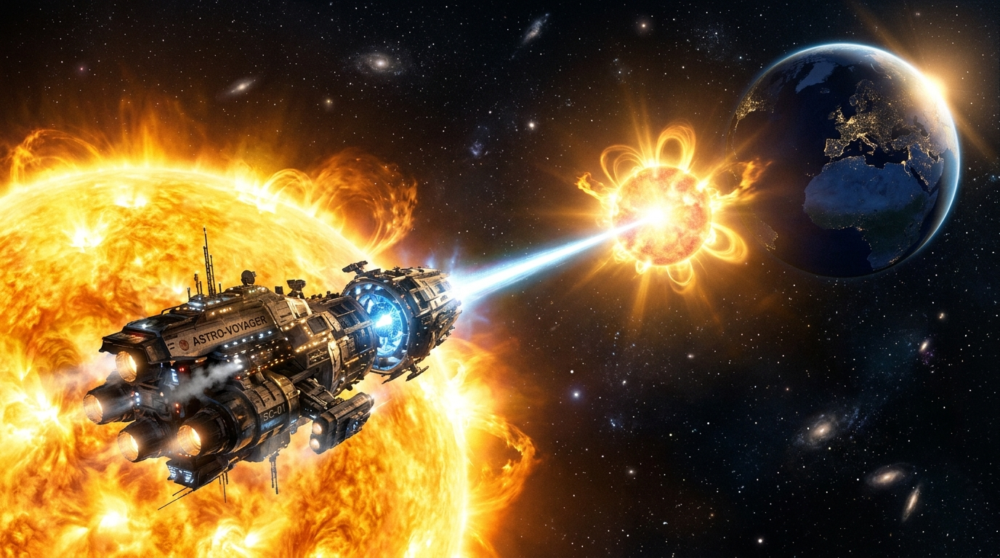<br>
      <b>Возрождение Солнца (Вечный Рассвет)</b><br>
      <sub>Квантовая инжекция антиматерии в солнечное ядро, спасение колыбели человечества</sub>
    </td>
    <td width="50%" align="center">
      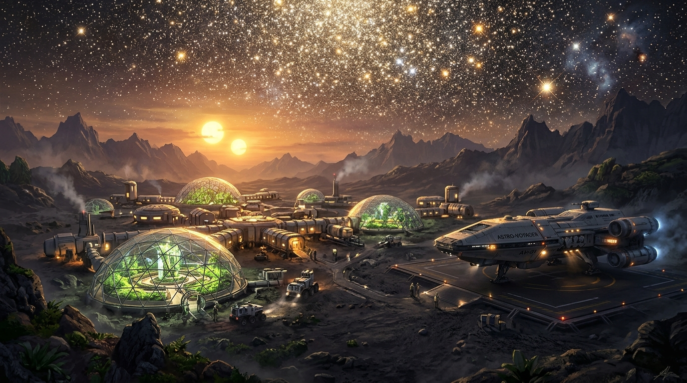<br>
      <b>Цветущий Эдем (Исход)</b><br>
      <sub>Основание новой биосферы на экзопланете Hercules-b среди бирюзовых океанов</sub>
    </td>
  </tr>
  <tr>
    <td width="50%" align="center">
      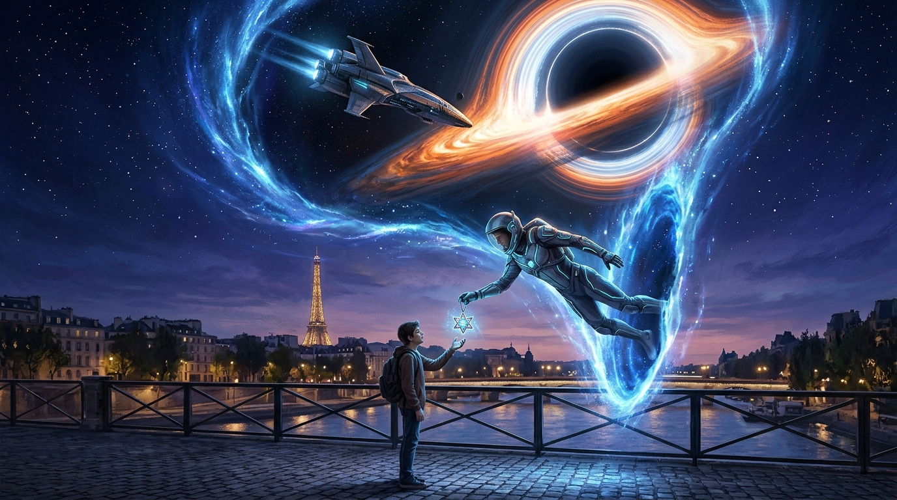<br>
      <b>Замкнутая Петля Времени (Вознесение)</b><br>
      <sub>Погружение в эргосферу Sgr A*, разлом пространства-времени над Парижем 2026 года</sub>
    </td>
    <td width="50%" align="center">
      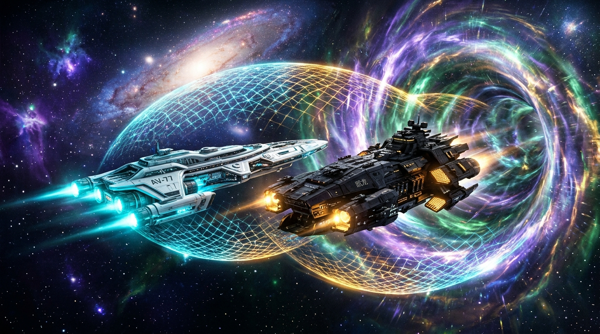<br>
      <b>Братство Пяти Миров (Архивариус)</b><br>
      <sub>Активация реликтового маяка Древних в ядре шарового скопления M13</sub>
    </td>
  </tr>
</table>

- **Статус проекта**: **v5.6.0 (Release 1.0 Candidate Stage)** (см. [`CHANGELOG.md`](CHANGELOG.md) и [`ROADMAP.md`](ROADMAP.md)). В игре полностью реализованы:
  - **Астрофизический реализм и оптика (v5.6.0)**: физическая модель микрофасеточных бликов Cook-Torrance GGX на океанах ($F_0 = 0.02$), рэлеевское и аэрозольное Ми-рассеяние в атмосферах, направленные тени облаков на экзопланетах, адаптивное ускорение шага марша черных дыр (экономия 25-35% шагов), субпиксельный LOD и фрустум-куллинг.
  - **Полная интеграция геймпадов и Steam Deck (v5.5.0)**: нативное управление полётом через аналоговые стики с радиальной мертвой зоной, аналоговые триггеры тяги/торможения, контекстные глифы кнопок и полная навигация по UI.
  - **Astro-Zettelkasten («Второй Мозг» Егорки, `B`)**: динамическая ассоциативная сеть мыслей и открытий с 4 сюжетными кластерами, тремя физическими моделями синтеза Эврики, вики-ссылками `[[...]]` и экспортом в Obsidian (подробнее: [`docs/wiki/ASTRO_ZETTELKASTEN.md`](docs/wiki/ASTRO_ZETTELKASTEN.md)).
  - **Кинематографичный Zero-UI HUD и Единый терминал корабля (`Tab`)**: 100% чистый кинематографичный космический полёт без визуального мусора и статических окон; динамические дуги тяги/вектора и щитов с плавным экспоненциальным затуханием (alpha fade), контекстный баннер `Action Horizon` при сближении с объектами и полноэкранный терминал управления кораблём на 5 системных вкладок (`[Tab]`: Навигация, Второй Мозг, Наука, Верфь, Журнал связи).
  - **Диегетический 3D-кокпит пилота**: коллиматорный ИЛС на бесконечности, полная авионика с расчётом перегрузок $G$-load, блэкаута/редаута и атмосферным ионизационным плазменным коконом.
  - **Модульная анимированная космическая станция**: раздельные PBR-модули с вращающейся жилой центрифугой искусственной гравитации ($\omega = 0.30\text{ рад/с}$), солнечными панелями с плавным SARJ-трекингом солнца и нулевым оверхедом по видеопамяти.
  - **Наука и посадка**: спектрометр фраунгоферовых линий (`C`), Кодекс открытий (`K`), живой радиоэфир экипажа, посадка с выдвижными гидравлическими опорами (`G`), бурение грунта (`F`) и кинематографический эпилог хроники.

### Астрофизический реализм, кокпит и варп-геометрия (v5.6.0)

<table>
  <tr>
    <td width="50%" align="center">
      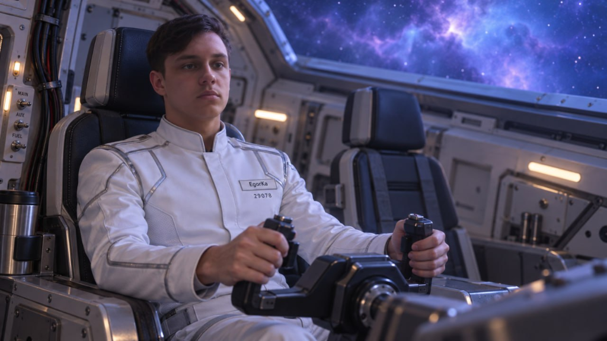<br>
      <b>Диегетический 3D-кокпит пилота</b><br>
      <sub>Коллиматорный ИЛС на бесконечности, MFD/PFD-дисплеи, расчёт перегрузок $G$-load, блэкаут/редаут и физиологический мониторинг</sub>
    </td>
    <td width="50%" align="center">
      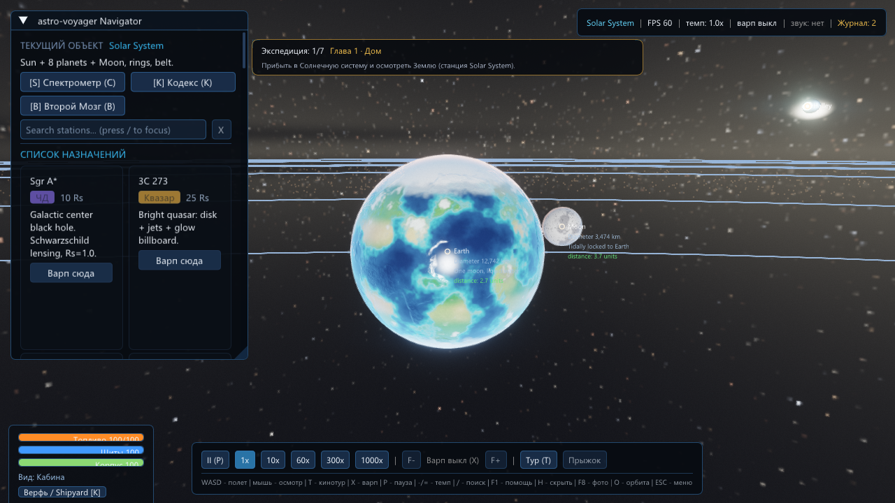<br>
      <b>Планетарная оптика и PBR-блики океанов</b><br>
      <sub>Микрофасеточная модель Cook-Torrance GGX ($F_0=0.02$), физическое рассеяние Рэлея-Ми и направленные тени облаков</sub>
    </td>
  </tr>
  <tr>
    <td width="50%" align="center">
      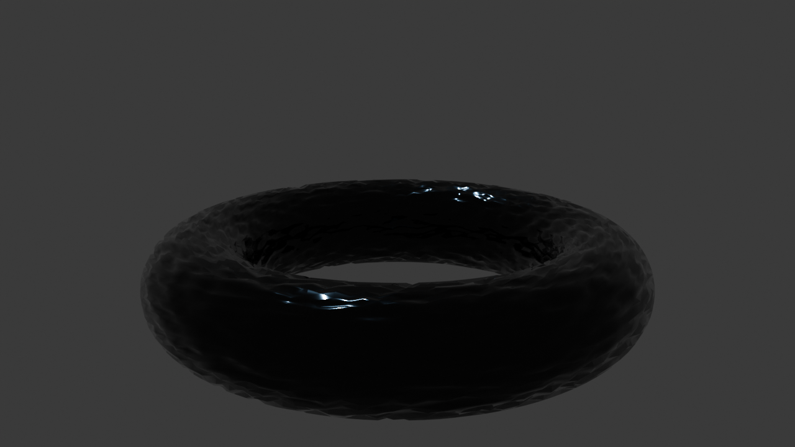<br>
      <b>Варп-тоннель Алькубьерре</b><br>
      <sub>Геодезическое 3+1 ADM-линзирование, сжатие метрики пространства и релятивистская деформация пузыря</sub>
    </td>
    <td width="50%" align="center">
      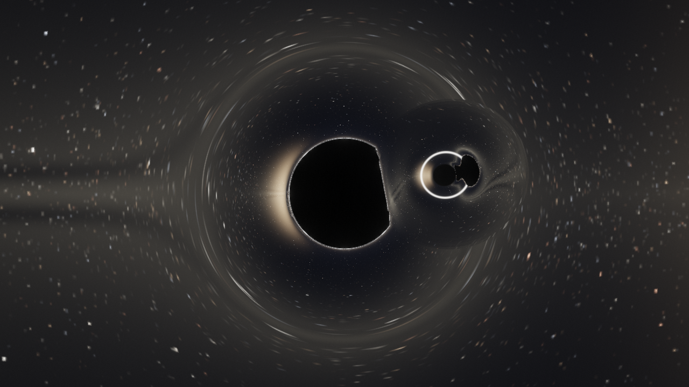<br>
      <b>Двойная чёрная дыра OJ 287</b><br>
      <sub>Прецессия вторичной дыры ($18.35 \times 10^9 M_\odot$), ударные пробои аккреционного диска и гравитационный захват</sub>
    </td>
  </tr>
</table>

*v5.6.0 (Release 1.0 Candidate) brings photorealistic atmospheric Rayleigh-Mie scattering, Cook-Torrance GGX microfacet ocean glints, far-field geodesic step acceleration, full Gamepad and Steam Deck navigation, and 6 True Endings with cinematic letterbox chronicles.*

### Новые механики: Ментальный граф мыслей, Созвездия и Анимации

<table>
  <tr>
    <td width="50%" align="center">
      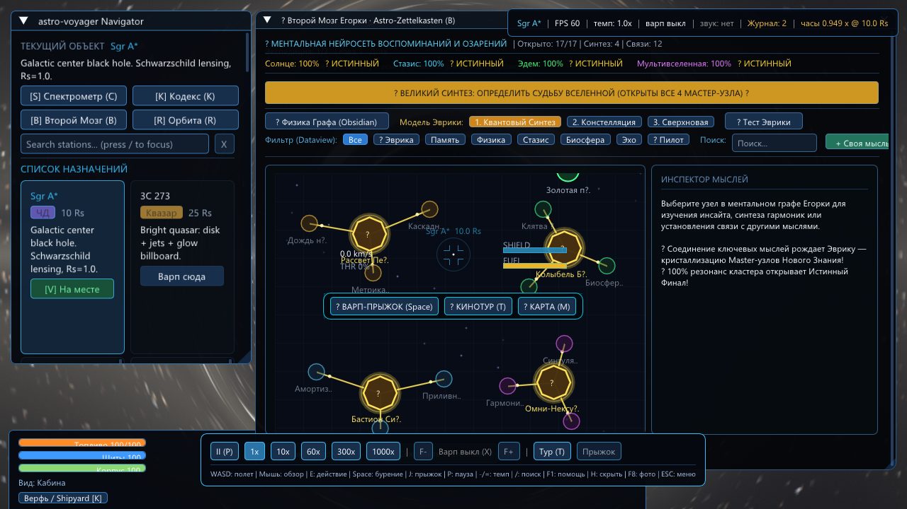<br>
      <b>Второй Мозг Егорки и Сеть Мыслей (Astro-Zettelkasten)</b><br>
      <sub>Ассоциативный ментальный граф воспоминаний и озарений (<code>[B]</code>), синтез физических моделей Эврики, резонансные кластеры концовок и Великий Синтез</sub>
    </td>
    <td width="50%" align="center">
      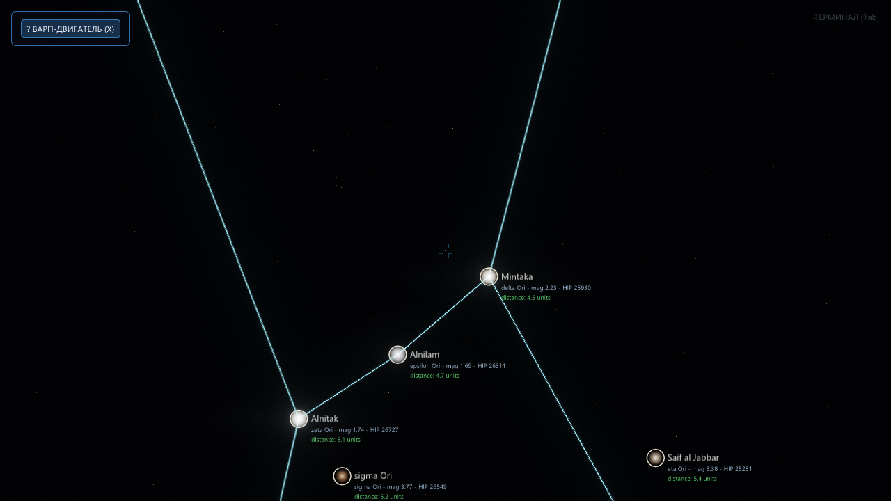<br>
      <b>Астрономические созвездия и каталог Hipparcos</b><br>
      <sub>Реальные звёзды пояса Ориона (Минтака, Альнилам, Альнитак, Бетельгейзе, Ригель), звёздные величины, дистанции и калибровка кулоном</sub>
    </td>
  </tr>
</table>

<table>
  <tr>
    <td width="33%" align="center">
      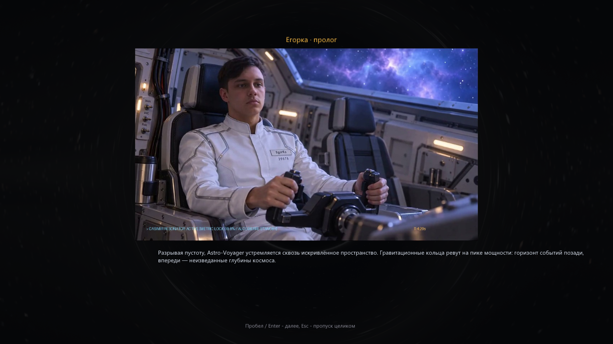<br>
      <b>Анимированная катсцена пролога</b><br>
      <sub>Покадровая кинематографичная анимация в 3D-кокпите: захват метрики Казимира, субтитры диалогов и телеметрия $T-4.20s$</sub>
    </td>
    <td width="33%" align="center">
      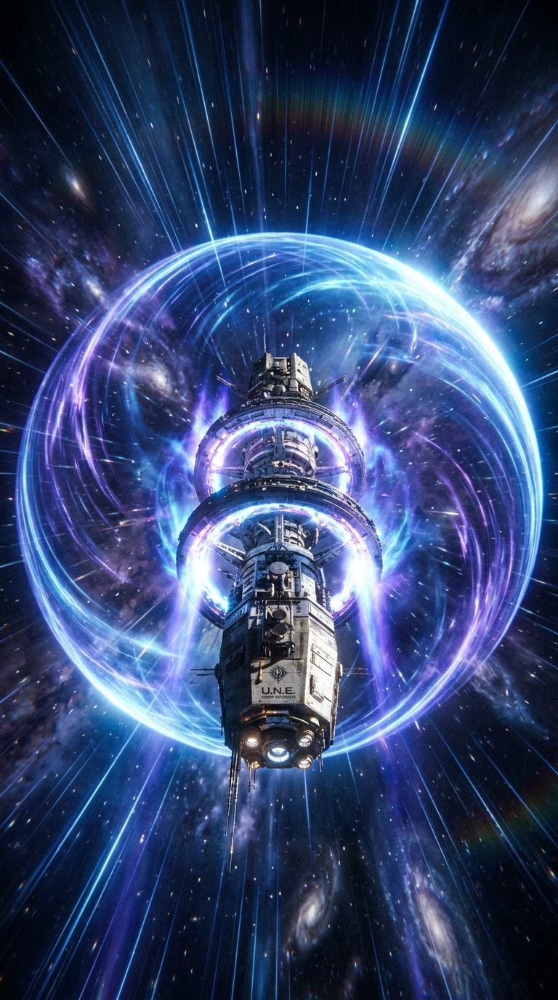<br>
      <b>Кинематографический варп-прорыв</b><br>
      <sub>Сверхсветовой скачок сквозь искривление пространства-времени с релятивистскими кольцами гравитационного фокуса</sub>
    </td>
    <td width="33%" align="center">
      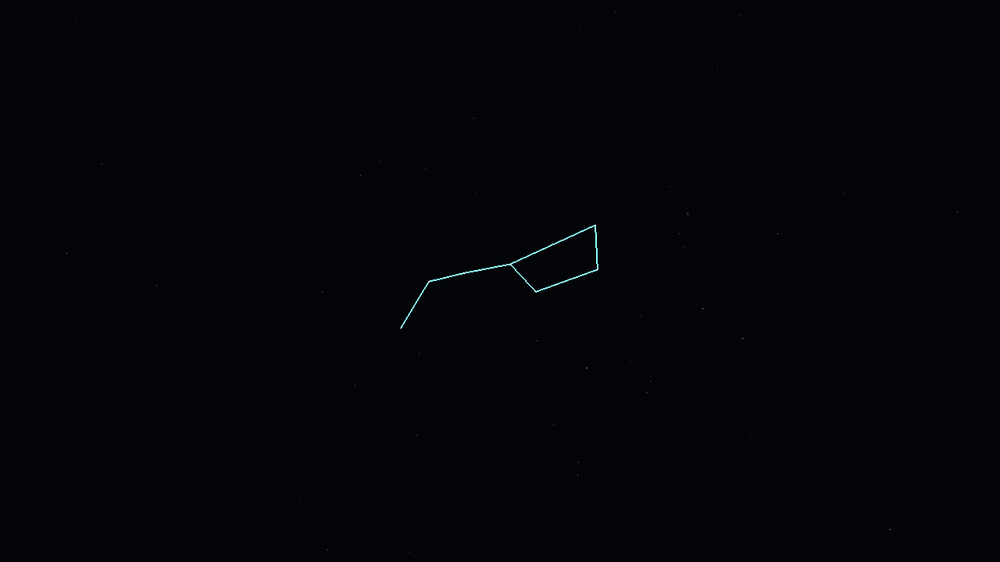<br>
      <b>Созвездие Большая Медведица</b><br>
      <sub>Геометрический астеризм Большого Ковша, астрометрическая сетка и навигация по звёздному атласу Deep Star Maps 2020</sub>
    </td>
  </tr>
</table>

### Zero-UI: Кинематографичный полет и Единый терминал корабля (v5.6.0)

<table>
  <tr>
    <td width="50%" align="center">
      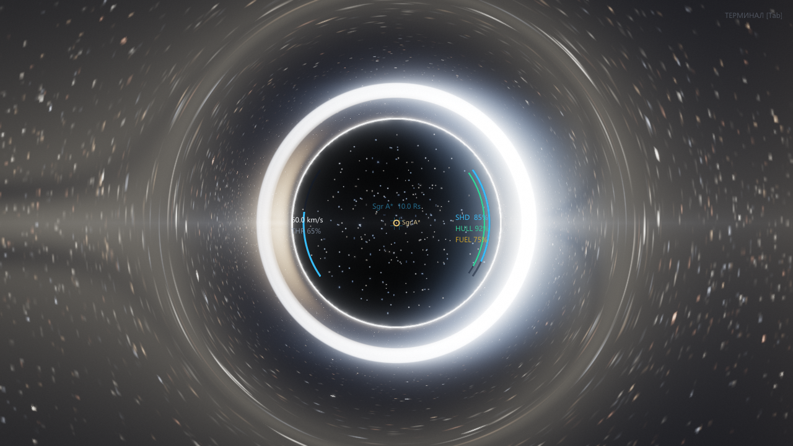<br>
      <b>Кинематографичный Zero-UI Flight HUD</b><br>
      <sub>Полное отсутствие статических окон и визуального шума в полёте: микро-ретикл, адаптивные дуги вектора тяги и щитов с плавным затуханием (alpha fade) при отсутствии угроз</sub>
    </td>
    <td width="50%" align="center">
      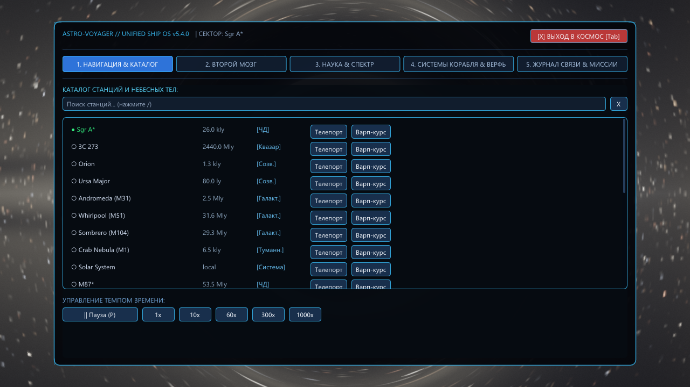<br>
      <b>Единый терминал корабля (Ship OS, <code>[Tab]</code> / Gamepad <code>[View]</code>)</b><br>
      <sub>Аэрокосмический кибер-терминал с 5 командными вкладками: Навигация с фильтром поиска, Второй Мозг, Наука и спектроскопия, Системы корабля и Журнал миссий</sub>
    </td>
  </tr>
</table>

---

## Флот кораблей и Верфь / Fleet & Shipyard

В игре доступно переключение между кораблями с кольцевым варп-приводом Алькубьерре и обычными досветовыми судами:

<table>
  <tr>
    <td width="50%" align="center">
      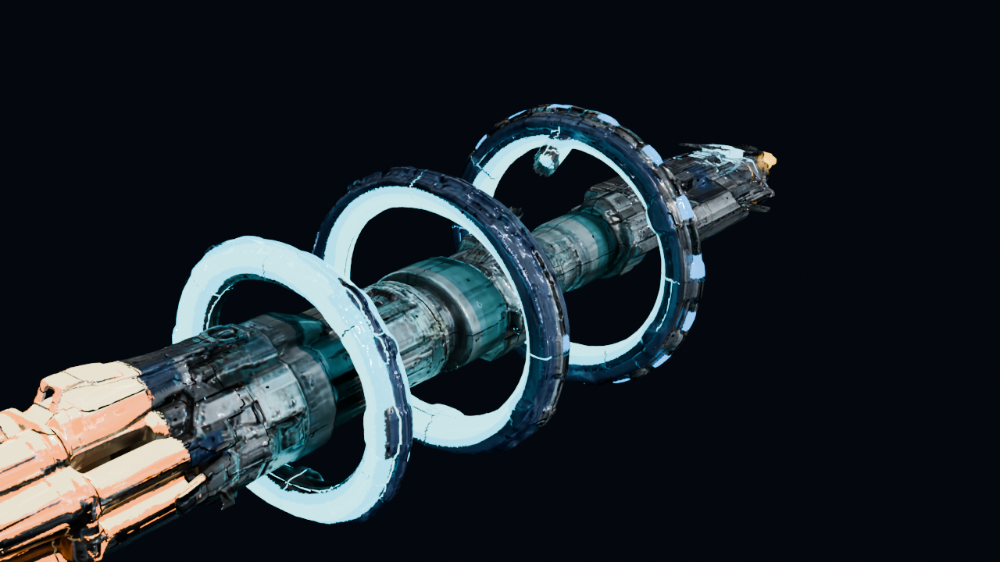<br>
      <b>Варп-корабль: Ring Ship IXS</b><br>
      <sub>Варп-катушки Алькубьерре, сверхсветовые прыжки (<code>X</code>, факторы 1–9), квантовое свечение плазменного ядра</sub>
    </td>
    <td width="50%" align="center">
      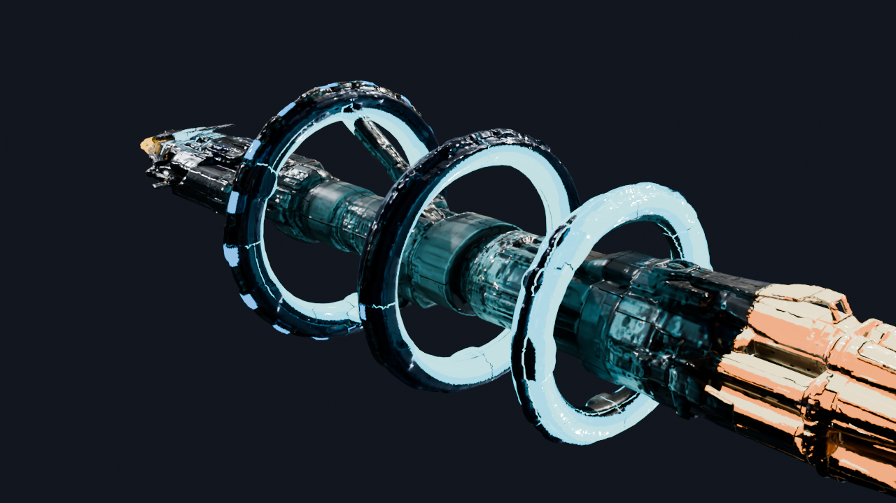<br>
      <b>Варп-корабль: Warp Cruiser</b><br>
      <sub>Флагман дальнего поиска, высокодетализированный PBR-корпус, IBL-освещение от окружения и навигационные огни</sub>
    </td>
  </tr>
  <tr>
    <td width="50%" align="center">
      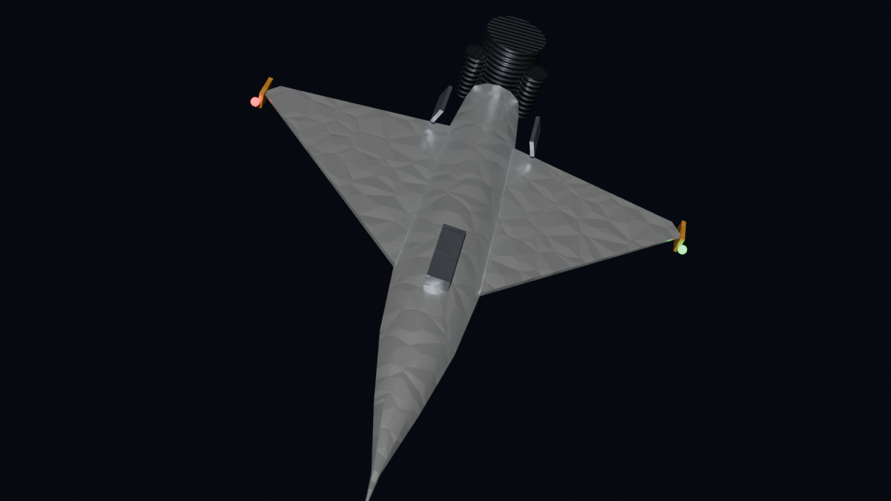<br>
      <b>Обычный корабль: Dart</b><br>
      <sub>Скоростной перехватчик/разведчик, стреловидное дельта-крыло, форсаж на обычном топливе (<code>Left Shift</code>)</sub>
    </td>
    <td width="50%" align="center">
      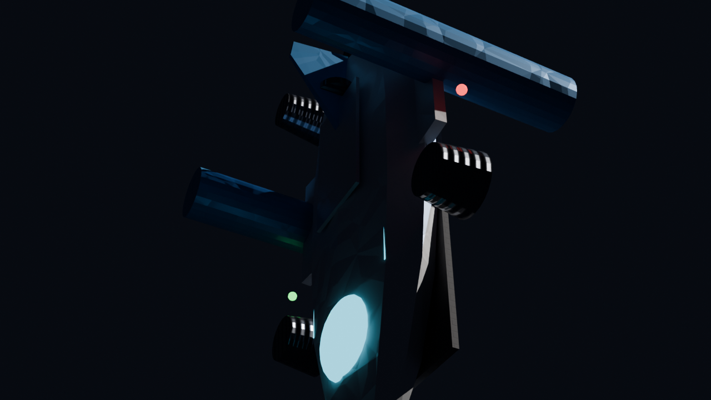<br>
      <b>Обычный корабль: Heavy Shuttle</b><br>
      <sub>Тяжёлый исследовательский челнок, сдвоенные мотогондолы, устойчивый досветовой атмосферно-орбитальный полёт</sub>
    </td>
  </tr>
</table>

<p align="center">
  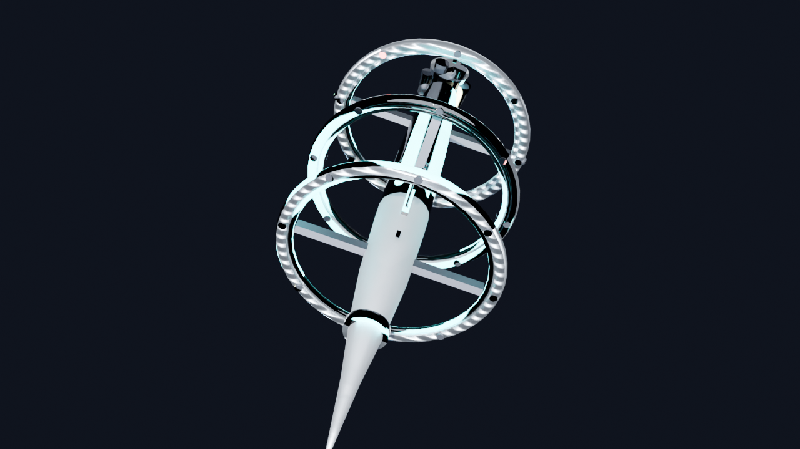
  <br>
  <sub><b>Ring Ship: три-кольцевой крейсер</b> — OBJ-корпус с PBR-обшивкой и тремя кольцами Алькубьерре; каждое кольцо держится на двух пилонах и вращается в собственной плоскости, а без модели остаётся процедурный корпус.</sub>
</p>

- **Варп-кольца**: три обруча Алькубьерре посажены на статические пилоны к корпусу, но не связаны друг с другом. Пилоны соседних колец развёрнуты на 90° (1 и 3 — горизонтальные, 2 — вертикальный), поэтому кольца не образуют продольную «клетку». Спин идёт строго в плоскости кольца, ходовые огни вращаются вместе с ободом.
- **Варп и досветовой режим**: аура и кокон деформации видны только при реальном варп-искажении — ни на холостом ходу, ни на обычном форсаже. `Left Shift` даёт форсаж на обычном топливе, в HUD он отмечается как `[BOOST]`, а шлейф/кокон стали заметно прозрачнее.

### Орбитальные станции и кастомизация (Верфь `[K]`)

<p align="center">
  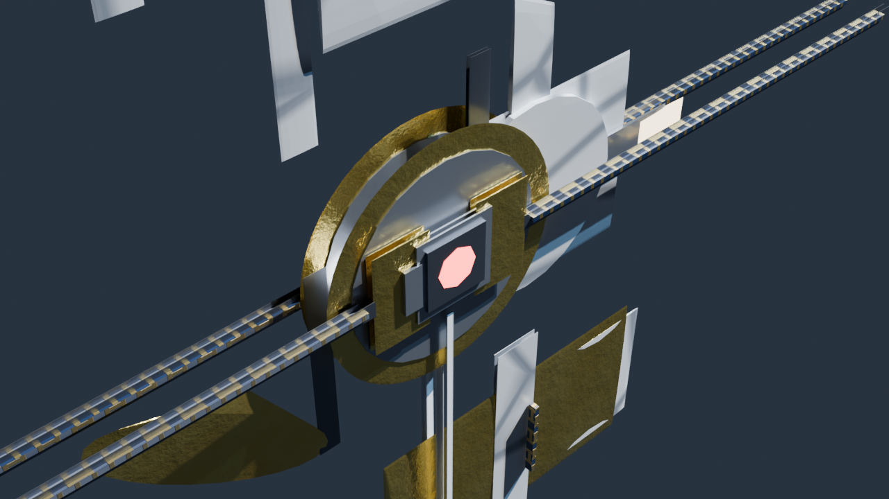
  <br>
  <sub><b>Орбитальная станция и космическая верфь</b>: высокодетализированная модульная 3D-модель МКС (International Space Station) с полной PBR-обшивкой (NASA 3D Resources / Public Domain reference). Интегрированная ферма ITS, модули USOS/ROS, радиаторы, жилая центрифуга искусственной гравитации и поворотные массивы солнечных батарей.</sub>
</p>

- **Модульная анимированная архитектура**: Станция разделена на независимые иерархические узлы (`station_core.obj`, `station_ring.obj`, `station_panels.obj`), использующие единый 4-зонный PBR-атлас текстур через `ObjModel::shareTexturesFrom()` без дублирования в видеопамяти.
  - **Жилая центрифуга**: Плавное непрерывное вращение тора и балансировочных спиц со скоростью $\omega = 0.30\text{ рад/с}$ вдоль продольной оси для создания искусственной силы тяжести.
  - **SARJ-трекинг панелей**: Медленный синусоидальный доворот фотоэлектрических панелей ($0.06 \cdot \sin(0.05 \cdot t)$) для оптимального угла падения солнечного излучения.
- **Стыковка (`K`)**: При сближении с орбитальной станцией (< 4.5 ед.) нажмите `[K]` для захвата доком. Скорость гасится, щиты, баки топлива и целостность корпуса мгновенно восполняются до 100%, открывается интерфейс Верфи.
- **Ангар (Hangar)**: Мгновенное переключение активного корабля: Dart (0), Ring Ship (1), Shuttle (2), Warp Cruiser (3). Варп-двигатель несут только Ring Ship и Warp Cruiser; Dart и Shuttle — досветовые, с ограниченным форсажем.
- **Целостность корпуса**: Радиация пульсаров и обломки изнашивают обшивку, док восстанавливает её до 100%, а HUD показывает третью шкалу. Побитый/восстановленный вид корпуса сохраняется в профиле.
- **Покрасочный цех (Paint Shop)**: Индивидуальная настройка цветов обшивки (`Hull Tint`), полос (`Accent Tint`) и свечения плазмы (`Emissive Tint`) с быстрыми пресетами (*Quantum Cyan*, *Plasma Violet*, *Solar Gold*, *Void Stealth*).
- **Инженерные модификации**: Апгрейды форсажа маршевых двигателей (+45%), энергоемкости щитов (+37%) и гармоники варп-катушек (-36% расхода топлива на прыжок). Полное сохранение в профиль `save-sandbox.json`.
- **Анимации обратной связи (Feedback Animations)**: Двухфазная стыковка и отшвартовка манипуляторов с HUD-прогресс-баром заправки, плавный переход смены корабля в ангаре и световой ореол телепорта к станциям.
  *Two-phase docking/undocking sequences with refueling progress bars, smooth hull swap transitions in the shipyard hangar, and warp-in halo flashes for station jumps.*

### NASA Science: зонды дальнего космоса

<p align="center">
  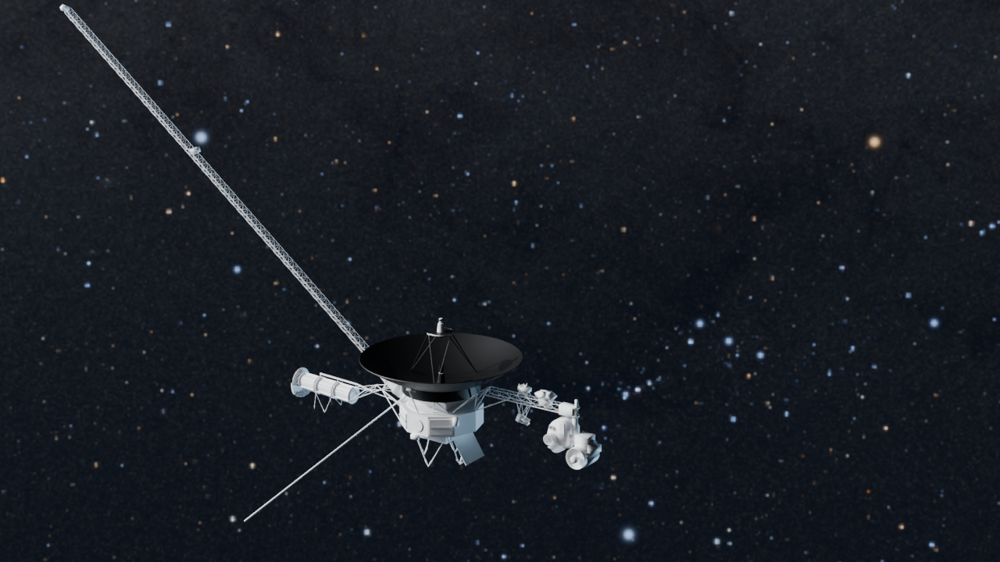
  <br>
  <sub><b>Voyager</b>: межзвёздный зонд с «Золотой пластинкой», 3,7-метровой антенной и развёрнутыми штангами научных приборов. Модель — NASA 3D Resources (public domain), фон — Deep Star Maps 2020 (NASA/Goddard SVS).</sub>
</p>

<table>
  <tr>
    <td width="50%" align="center">
      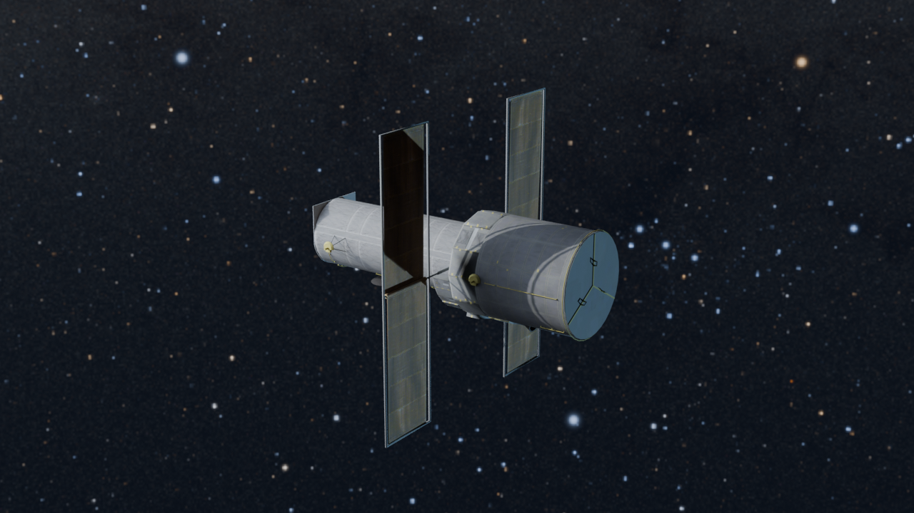<br>
      <b>Hubble Space Telescope</b><br>
      <sub>Орбитальная обсерватория с солнечными панелями и защитной блендой; модель NASA 3D Resources.</sub>
    </td>
    <td width="50%" align="center">
      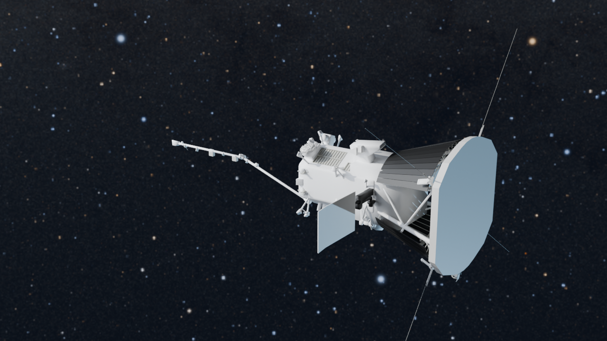<br>
      <b>Parker Solar Probe</b><br>
      <sub>Солнечный зонд с теплозащитным экраном и научной штангой; модель NASA 3D Resources.</sub>
    </td>
  </tr>
</table>

- **Источники**: официальные GLB-модели NASA 3D Resources и карта всего неба Deep Star Maps 2020. Тяжёлые исходники не коммитятся — их скачивает `tools/fetch_nasa_assets.ps1`, а витрины рендерит `blender/scripts/render_nasa_showcase.py`. Подробности, SHA256 и кредиты: [`docs/NASA_ASSETS.md`](docs/NASA_ASSETS.md).

### Реальная пилотируемая космонавтика: SpaceX, Союз и «Мир»

<table>
  <tr>
    <td width="33%" align="center">
      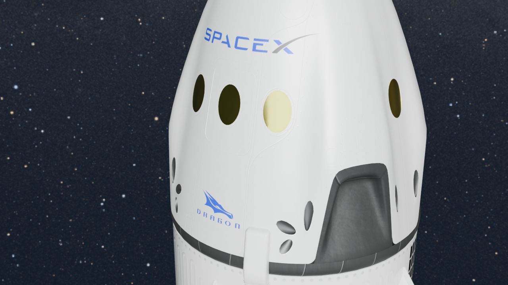<br>
      <b>SpaceX Crew Dragon</b><br>
      <sub>Пилотируемый корабль нового поколения, PBR-обшивка, радиаторы багажного отсека и носовой обтекатель</sub>
    </td>
    <td width="33%" align="center">
      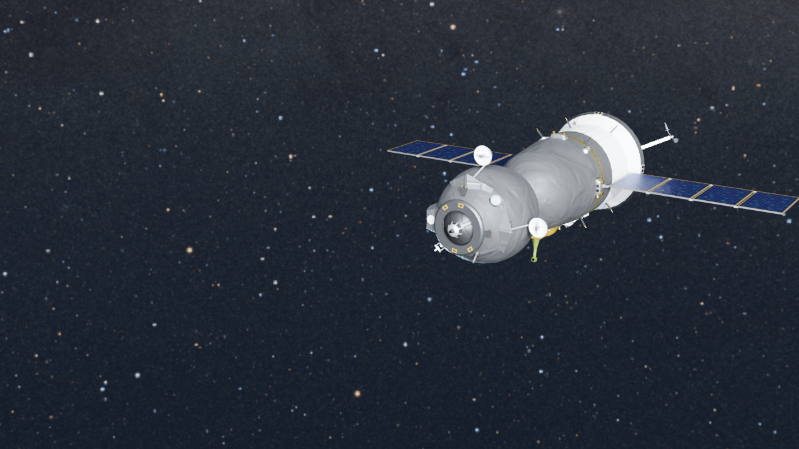<br>
      <b>«Союз-МС»</b><br>
      <sub>Пилотируемый корабль: спускаемый аппарат, бытовой и приборно-агрегатный отсеки с солнечными батареями</sub>
    </td>
    <td width="33%" align="center">
      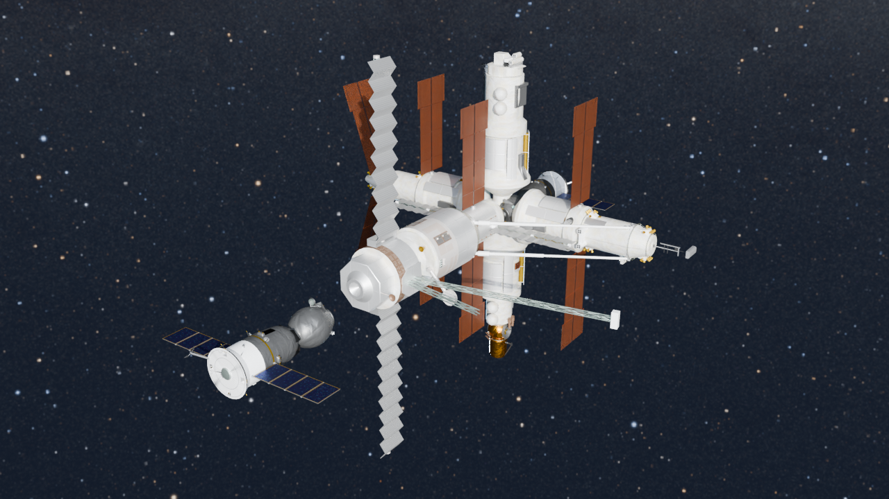<br>
      <b>Орбитальная станция «Мир»</b><br>
      <sub>Исторический многомодульный орбитальный комплекс («Базовый блок», «Квант-1/2», «Кристалл», «Спектр», «Природа»)</sub>
    </td>
  </tr>
</table>

### Атрибуция 3D-моделей

- **SpaceX Crew Dragon 2 exterior** — Jon Ross ([zlsa](https://sketchfab.com/zlsa)), лицензия [CC BY 4.0](https://creativecommons.org/licenses/by/4.0/), источник: [Sketchfab](https://sketchfab.com/3d-models/spacex-dragon-2-exterior-2575398db20c406cab2cf72b89a9be8b). Модель локальная и не коммитится; экспорт и масштаб описаны в [`docs/SPACECRAFT_ASSETS.md`](docs/SPACECRAFT_ASSETS.md).
- **Mir Station with Soyuz and Progress docked** — [tashtego](https://sketchfab.com/tashtego), лицензия [CC BY-NC 4.0](https://creativecommons.org/licenses/by-nc/4.0/), источник: [Sketchfab](https://sketchfab.com/3d-models/mir-station-with-soyuz-and-progress-docked-bd6ac084ae5645848a67597b17665579). **NC**: коммерческое использование модели запрещено без отдельного разрешения; для коммерческой поставки «Союз» нужно заменить на permissive-ассет.

---

## Наука, Спектроскопия и Кодекс / Science & Codex

- **Астрофизический научный спектрометр (`C`)**: Полнофункциональный спектральный анализ небесных тел в реальном времени. Включает непрерывный планковский спектр абсолютно чёрного тела, фраунгоферовы линии поглощения (водородная серия Бальмера $H_\alpha, H_\beta$, гелий $He\text{ I}$, дублет натрия $Na\text{ D}$, кальций $Ca\text{ II}$), эмиссионные линии туманностей ($[O\text{ III}], [N\text{ II}]$) и релятивистский доплеровский сдвиг длин волн при сближении или удалении. Первичное сканирование каждого объекта приносит **+100 Research Points (RP)** в общий научный прогресс экспедиции.
- **Бортовой Кодекс космических открытий (`K` в свободном полёте)**: Научно-исследовательская база данных экспедиции, охватывающая 12 астрофизических категорий (сверхмассивные чёрные дыры, релятивистские квазары, миллисекундные пульсары, магнетары, гравитационно-волновые килоновые, планеты земной группы, газовые гиганты и др.). Отображает статус сканирования, астрофизические параметры, координаты и историю открытий с трекингом заработанных очков науки.
- **Живой радиоэфир мостика (Live Bridge Radio Chatter)**: Динамическая система радиопереговоров и тост-уведомлений экипажа. Пилот Мия Сато, астрофизик д-р Елена Ростова, кибер-штурман Егорка-6, командир Марк Хейл и Земной ЦУП оперативно комментируют посадку на поверхность, спектральные находки, гравитационные аномалии и вход в релятивистские зоны.

---

## Посадка на планеты и авионика / Planetary Landing & Avionics

- **Выдвижное гидравлическое шасси (`G`)**: Анимированные трёхточечные посадочные опоры с плавным выпуском/уборкой и звуковым сопровождением гидравлики. Статус шасси (`GEAR DOWN` / `GEAR UP`) отображается на коллиматорном ИЛС.
- **Физика посадки и контакт с поверхностью**: Честный расчёт динамического сжатия амортизаторов, сопротивления грунта и гашения вертикальной скорости. Мягкая посадка фиксируется при вертикальной скорости $< 3.5\text{ м/с}$ и угле крена $< 15^\circ$. При превышении безопасной скорости срабатывает предупреждение об опасности крушения.
- **Реголитовая пыль и экспедиции на грунт**: При работе маневровых двигателей у поверхности генерируется динамический шлейф пыли и реголита (dust kickup). После успешной посадки формируется полевой научный отчёт экспедиции с начислением **+150 Research Points (RP)**.
- **Полётная авионика и физиология пилота**: На коллиматорном индикаторе (ИЛС) отображаются маркеры вектора скорости (Prograde $\odot$) и вектора торможения (Retrograde $\otimes$), радиовысотомер истинной высоты над рельефом (AGL), вертикальная скорость (V/S) и вектор ускорения. В реальном времени ведётся непрерывный расчёт перегрузок $G$-load с визуализацией физиологического состояния пилота (потемнение в глазах/блэкаут при положительных перегрузках, покраснение/редаут при отрицательных) и плазменная ионизация атмосферы при гиперзвуковом входе.
- **Релятивистская двойная чёрная дыра OJ 287**: Моделирование кеплеровской орбиты и постньютоновской прецессии вторичной чёрной дыры вокруг сверхмассивного первичного компаньона ($18.35 \times 10^9 M_\odot$). Симулируются периодические пробои аккреционного диска с мощными оптическими вспышками и кинематографический захват горизонта событий при сближении.

---

## Галерея космических объектов

<table>
  <tr>
    <td width="50%">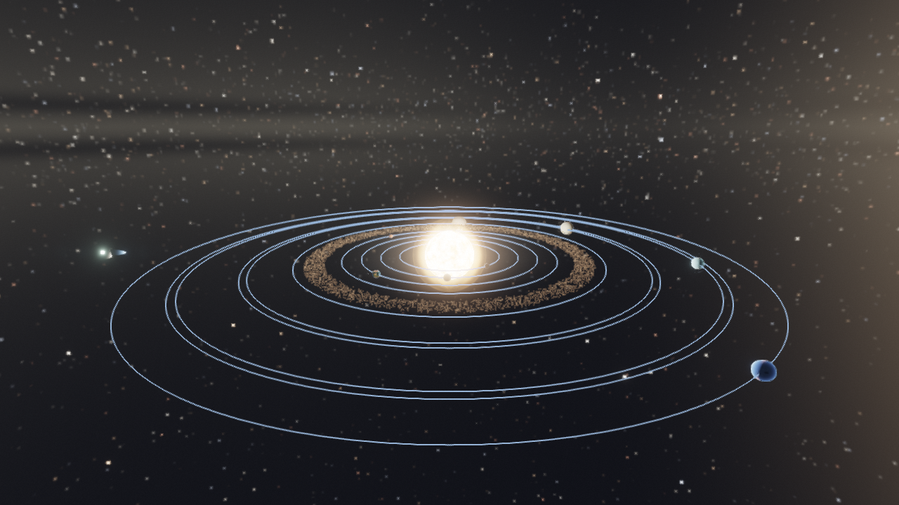<br><sub><b>Солнечная система</b>: 8 планет с осевым вращением, Сатурн с тенью колец и делением Кассини, спутники и пояс астероидов</sub></td>
    <td width="50%">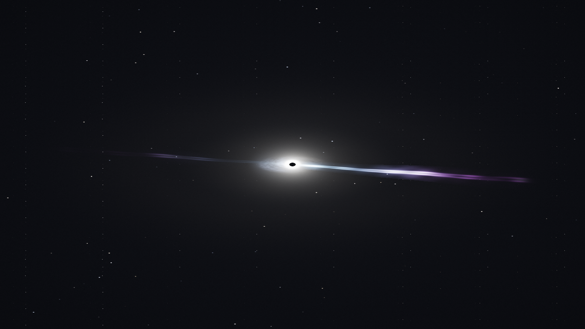<br><sub><b>Квазар 3C 273</b>: сверхъяркое ядро, релятивистские джеты с прецессией и вторичные гравитационные дуги</sub></td>
  </tr>
  <tr>
    <td>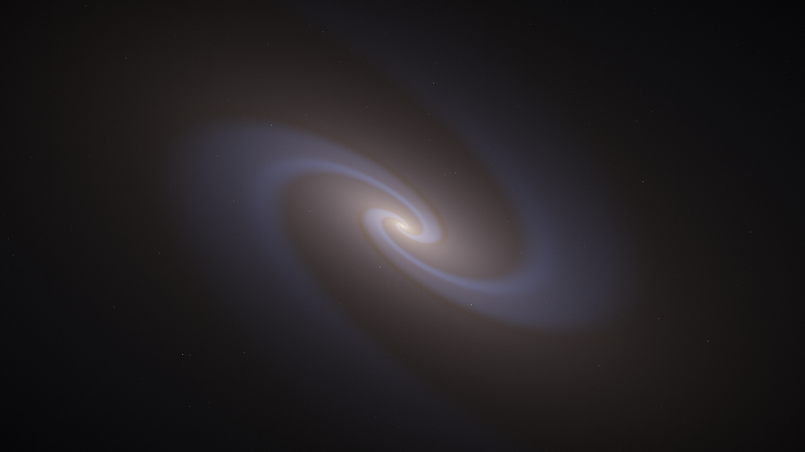<br><sub><b>Галактика Андромеда (M31)</b>: рукава из звёзд-частиц, динамический LOD-зум и приливной звездный поток</sub></td>
    <td>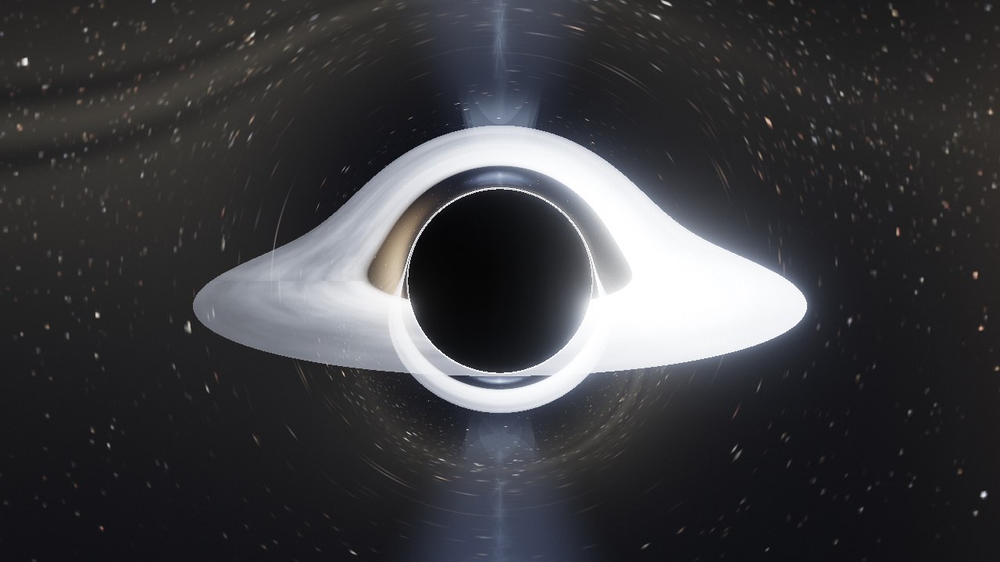<br><sub><b>M87*</b>: сверхмассивная чёрная дыра с синхротронным джетом и движущимися плазменными узлами HST-1</sub></td>
  </tr>
  <tr>
    <td>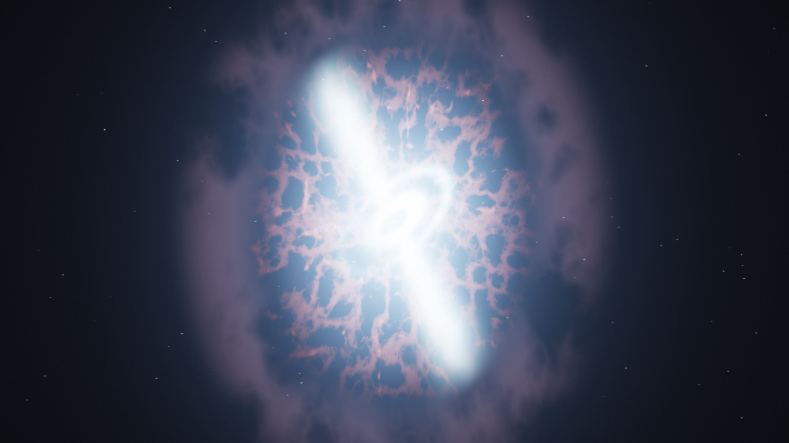<br><sub><b>Крабовидная туманность (M1)</b>: остаток сверхновой, пульсар со строб-маяком и волокна синхротронного излучения</sub></td>
    <td>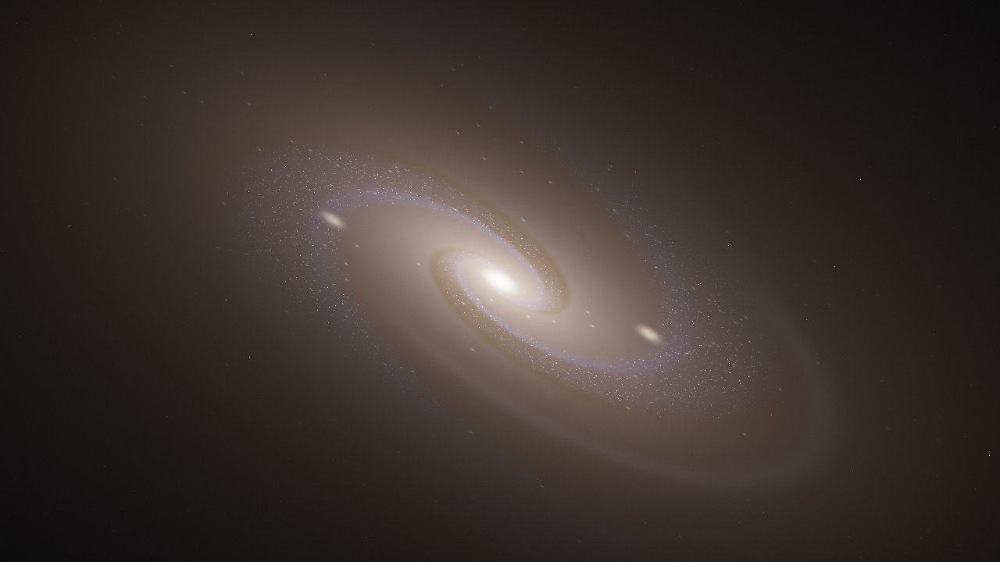<br><sub><b>Галактика Сомбреро (M104)</b>: массивная пылевая полоса вдоль экватора диска и сфероидальный балдж</sub></td>
  </tr>
</table>

### Космические катаклизмы и релятивистские явления

<table>
  <tr>
    <td width="50%" align="center">
      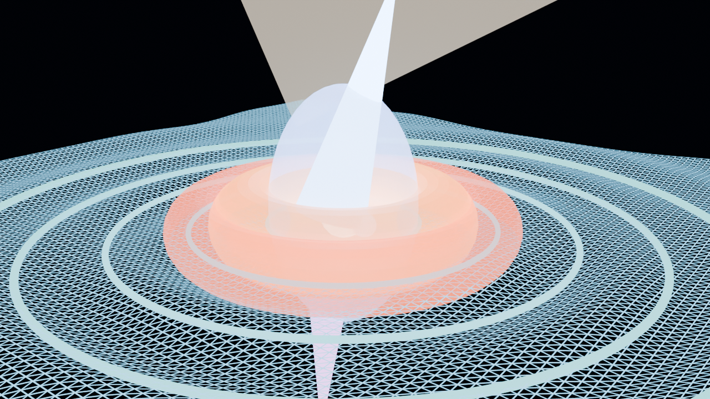<br>
      <b>Килоновая GW170817 (Слияние нейтронных звёзд)</b><br>
      <sub>Гравитационно-волновой всплеск, r-процесс нуклеосинтеза тяжёлых элементов и релятивистский джет</sub>
    </td>
    <td width="50%" align="center">
      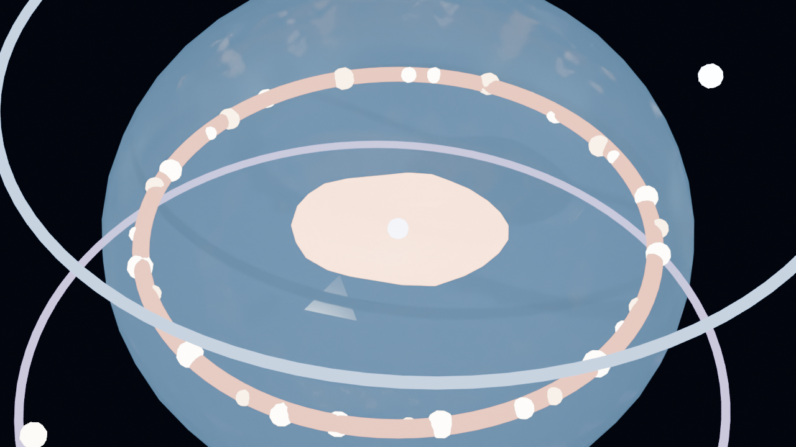<br>
      <b>Сверхновая SN 1987A (Остаток в БМО)</b><br>
      <sub>Ударное кольцо с горячими плазменными узлами, расширяющийся рентгеновский пузырь и центральный пульсар</sub>
    </td>
  </tr>
  <tr>
    <td width="50%" align="center">
      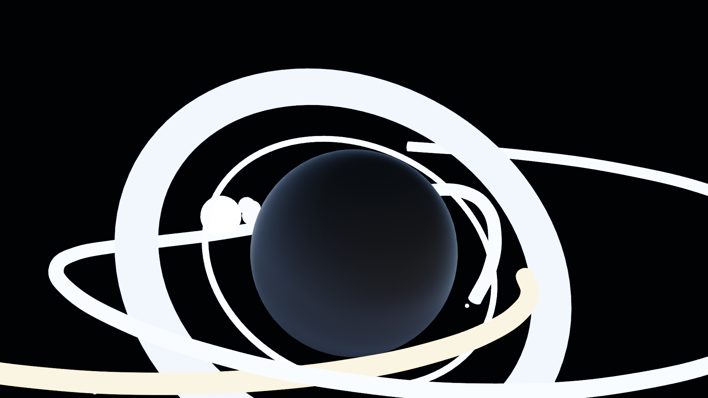<br>
      <b>Приливное разрушение звезды AT2019qiz</b><br>
      <sub>Спагеттификация звезды черной дырой, оптический супер-аутбёрст и релятивистский аккреционный хвост</sub>
    </td>
    <td width="50%" align="center">
      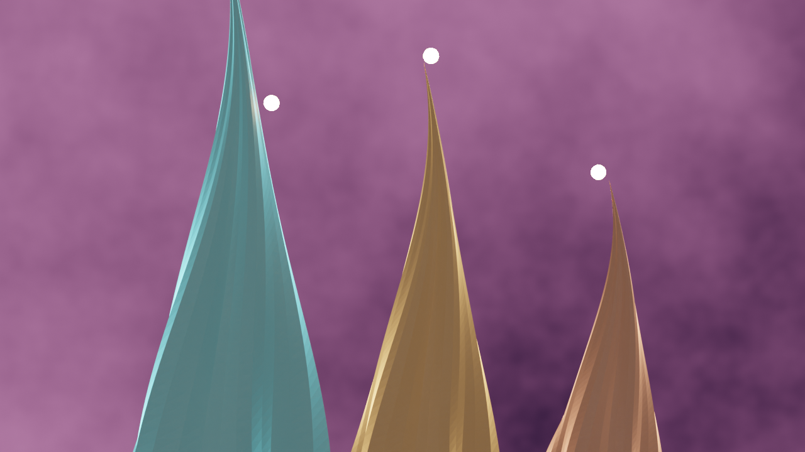<br>
      <b>Столпы Творения (Туманность Орёл M16)</b><br>
      <sub>Инфракрасные и оптические режимы визуализации газопылевых колонн, фотоиспарение ультрафиолетом молодых звёзд</sub>
    </td>
  </tr>
</table>

Полный каталог включает 22 уникальных объекта: Sgr A*, 3C 273, M87*, OJ 287, Hyperdisk, M31, M51, M104, Млечный Путь, Скопление M13, Столпы Творения (M16), Приливное разрушение AT2019qiz, Крабовидную туманность (M1), килоновую GW170817, сверхновую SN 1987A, пульсары Vela/Crab/B1913+16, магнетар SGR 1806-20, созвездия Орион и Большая Медведица (подробнее см. [`docs/CATALOG.md`](docs/CATALOG.md)).

---

## Управление / Controls

> [!TIP]
> **Action Horizon (Интуитивное управление)**: Прямо под прицельным перекрестием отображается интерактивный контекстный баннер. Все ключевые действия (посадка, взлёт, орбитальный круиз, бурение, спектрометрия, варп-прыжок) доступны как по горячим клавишам, так и по прямому клику мыши на светящиеся кнопки. Полная поддержка геймпадов Xbox / DualSense / Steam Deck с адаптивными глифами подсказок `[A]`, `[B]`, `[X]`, `[Y]`, `[RT]`.

### Клавиатура и мышь / Keyboard & Mouse

| Клавиша | Действие |
|---|---|
| **WASD** + мышь | Свободный полёт камеры и управление кораблём (тангаж, рыскание, крен) |
| **Tab** | **Единый терминал корабля (Ship OS Terminal)**: переключение бортового терминала управления (5 вкладок: Навигация, Второй Мозг, Наука, Верфь, Журнал) |
| **Left Shift** | Форсажное ускорение маршевых двигателей (`[BOOST]` в HUD) |
| **X** / **[** **]** | Варп-привод (факторы 1–9) и сверхсветовые прыжки; линзирование — при активном варпе |
| **B** | **Astro-Zettelkasten («Второй Мозг» Егорки)**: ассоциативная сеть знаний, гипотезы и синтез Эврики |
| **G** | Шасси: выпуск / уборка гидравлических посадочных опор (`GEAR DOWN` / `GEAR UP`) |
| **F** | Бурение керна и сбор геологических образцов на грунте планеты |
| **E** | Контекстное действие: Посадка на планету / Взлёт на орбиту / Стыковка со станцией |
| **R** | Орбитальный круиз: выход на стабильную кеплеровскую орбиту вокруг небесного тела |
| **C** | Астрофизический научный спектрометр: сканирование линий поглощения/эмиссии (+100 RP) |
| **K** | Кодекс открытий (в полёте) / Стыковка со станцией и Верфь кастомизации (вблизи станции) |
| **J** | Бортовой журнал сюжетной кампании (Story Journal) |
| **N** | Навигационная карта глав Экспедиции |
| **V** | Переключение камеры: кокпит (1-е лицо с авионикой) / внешний вид (3-е лицо) |
| **O** | Орбитальный ассистент: автоматическая стабилизация курсирования и горизонта |
| **F8** | Фоторежим: Photo Mode v2 (свободная орбитальная камера, глубина резкости, скрытие HUD) |
| **Дабл-клик** | Автоматический подлёт к выбранному небесному объекту |
| **/** | Быстрый нечёткий поиск по станциям каталога, `Enter` — мгновенный переход |
| **T** / Пробел | Кинематографический тур с автопилотом / пропуск катсцены |
| **-** **=** / **P** | Ускорение времени (до 1000x) / Пауза симуляции |
| **M** | Звук: включение / отключение процедурного звукового движка и эффектов |
| **F5** / **F6** | Экспорт / импорт навигационного маршрута полёта |
| **F9** / **F10** | Быстрое сохранение / загрузка профиля (`save-sandbox.json` / `save-adventure.json`) |
| **H** / **F1** | Скрыть интерфейс / Экран помощи |

### Геймпад / Gamepad & Steam Deck

| Орган управления | Действие |
|---|---|
| **Левый стик (LS)** | Полёт: тангаж (Pitch) и рыскание (Yaw) с радиальной мертвой зоной |
| **Правый стик (RS)** | Осмотр камеры / крен (Roll) / аналоговая прокрутка свитков хроники |
| **RT** / **LT** | Аналоговый форсаж маршевых двигателей / торможение и реверс |
| **Кнопка A** | Контекстное действие: Посадка / Взлёт / Стыковка / Выбор в меню |
| **Кнопка B** | Отмена / Назад / Закрытие модального окна |
| **Кнопка X** | Сверхсветовой варп-прыжок / переход к началу свитка |
| **Кнопка Y** | Сканирование спектрометром / экспорт логов экспедиции |
| **LB** / **RB** | Переключение ступеней варп-фактора (Warp 1–9) |
| **Back / View** | **Единый терминал корабля (Ship OS Terminal)**: переключение бортового терминала |
| **D-Pad (Крестовина)** | Навигация по спискам Кодекса, Журнала и пунктам меню |
| **Start / Menu** | Главное меню / Пауза симуляции |

---

## Физическая модель и CPU-геометрия

1. **Гравитационное линзирование (GPU `shaders/bh.frag`)**: численное интегрирование нулевых геодезических в метрике Шварцшильда (RK4-трассировка лучей в реальном времени), моделирование тонкого аккреционного диска Новикова-Торна с учётом релятивистского биминга и гравитационного красного смещения. При разгоне включается релятивистский доплер-тинт и звёздная аберрация.
2. **Метрика Керра (CPU `src/Kerr.cpp`)**: точный расчёт нулевых геодезических вращающейся чёрной дыры со спином $|a| \le M$ без аппроксимаций (`./build/astro-voyager --demo-kerr`).
3. **Варп-геометрия (CPU `src/WarpMetric.h`, `src/WarpGeodesic.h`)**: универсальный 3+1 ADM-фреймворк, метрика пузыря Алькубьерре `AlcubierreMetric` с гладкой $\sigma$-стенкой, скаляр расширения Йорка $\theta_{\max}$ и генератор траекторий `skiffPath` с вычисляемым зазором до внутренней стенки пузыря и темпом координатного времени $dt_s/d\tau = 1/\mathrm{lapse}$ (`./build/astro-voyager --demo-warp`). На GPU варп-прыжки выполняются в кинематографическом режиме с визуальным шейдерным коконом и линзой деформации пространства.

---

## Быстрый старт и сборка

### Сборка headless core (CLI-инструменты и физические тесты)
```bash
cmake -S . -B build -DCMAKE_BUILD_TYPE=Release
cmake --build build --config Release
./build/astro-voyager --list
./build/astro-voyager --demo-warp
./build/astro-voyager --demo-kerr
```

### Запуск полного 3D-приложения (OpenGL 3.3 Core)
Для сборки графического окна требуется опция `ASTROVOYAGER_ENABLE_GL=ON` (подробнее см. [`docs/BUILD.md`](docs/BUILD.md)):
```bash
cmake -S . -B build-gl -DASTROVOYAGER_ENABLE_GL=ON -DCMAKE_BUILD_TYPE=Release
cmake --build build-gl --config Release
./build-gl/Release/astro-voyager.exe --gl
```

---

## Тестирование и валидация

```powershell
powershell -ExecutionPolicy Bypass -File tests/test_static_checks.ps1
ctest --test-dir build -C Release
```

CI автоматически проверяет сборку на Windows, Ubuntu Linux и macOS, собирает Linux AppImage и портативные архивы с хэш-суммами `CHECKSUMS.txt`.

> [!NOTE]
> **Windows SmartScreen**: Неподписанные портативные exe-файлы могут вызывать предупреждение SmartScreen. Нажмите «Подробнее → Выполнить в любом случае» или в свойствах файла отметьте галочку «Разблокировать». Хэши SHA-256 всегда приведены в файле релиза (подробнее см. [`docs/RELEASE.md`](docs/RELEASE.md)).
