# astro-voyager

[](https://github.com/remageht/astro-voyager/actions/workflows/build.yml)
[](https://github.com/remageht/astro-voyager/releases)


Физически корректный 3D-симулятор Вселенной на **C++17** и **OpenGL 3.3 Core**. Численное релятивистское RK4-линзирование черных дыр в реальном времени, сверхсветовой варп-привод Алькубьерре, орбитальные гиперврата перехода, интерактивная 3D Мастерская с каталогом из 58 высокополигональных моделей с 2K PBR-текстурами, 24-этапная система планетарных колоний и диегетический 3D-кокпит с Zero-UI.

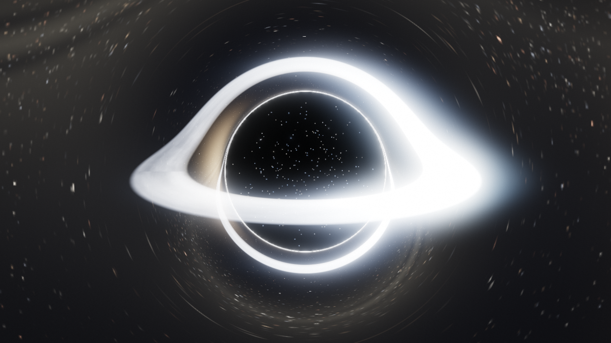
*Сверхмассивная чёрная дыра Sgr A*: численное RK4-линзирование в метрике Шварцшильда, тень горизонта, фотонное кольцо и тонкий аккреционный диск Новикова-Торна с релятивистским доплеровским бимингом.*

---

## Скачать и играть / Download & Play

Готовые автономные сборки без необходимости компиляции и установки:
- 🎮 **Windows (x86_64)**: [astro-voyager-v5.1.0-windows-x86_64-portable.zip](https://github.com/remageht/astro-voyager/releases/latest) (полный автономный портативный архив со всеми 3D-моделями, текстурами и аудио).
- 🐧 **Linux (x86_64)**: [astro-voyager-x86_64.AppImage](https://github.com/remageht/astro-voyager/releases/latest) (`chmod +x *.AppImage && ./*.AppImage`) или `tar.gz` портативный архив.
- 🍏 **macOS (Apple Silicon arm64)**: [astro-voyager-macos-arm64.tar.gz](https://github.com/remageht/astro-voyager/releases/latest) (нативная сборка OpenGL 3.3 Core).

*Требования*: Видеокарта с поддержкой OpenGL 3.3 Core Profile (Intel HD 4000+, NVIDIA GTX 600+, AMD HD 7000+).

### Диагностика
- `astro-voyager.exe --diagnostics` — выводит информацию о видеокарте, версии OpenGL и драйвере.
- `astro-voyager.exe --safe` — безопасный режим с уменьшенным числом шагов маршинга и отключенным FXAA.
- Лог запуска пишется в `astro-voyager.log` рядом с исполняемым файлом.

---

## 🌟 Интерактивная 3D Мастерская моделей / 3D Model Workshop (v5.1.0+)

Полноэкранная интерактивная 3D Мастерская доступна прямо из **Главного Меню** и бортового терминала (`Tab` → Инспектор). Позволяет детально исследовать все 58 моделей в режимах **PBR (Cook-Torrance GGX)** и **Studio Clay (Студийная глина)** со свободной орбитальной камерой, координатной сеткой и физической телеметрией.

<p align="center">
  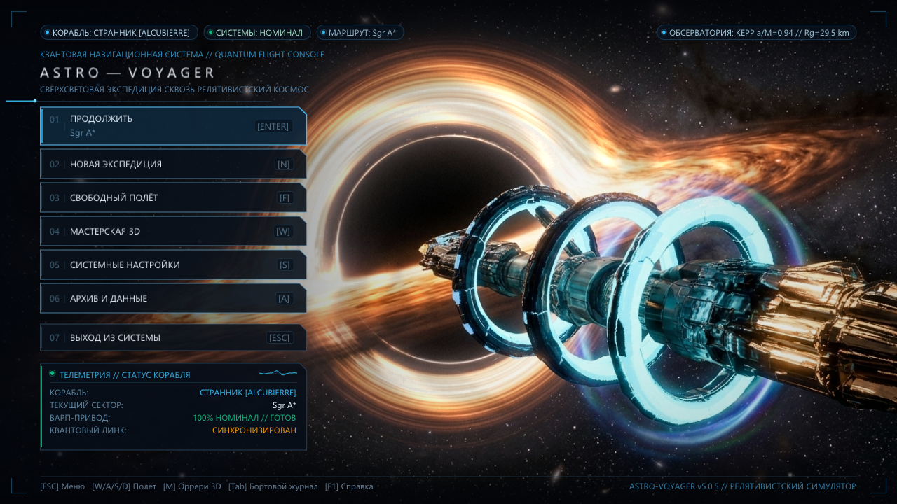
  <br>
  <sub><b>Главное меню v5.1.0+</b>: прямой доступ к 3D Мастерской моделей, тактические кнопки быстрого выбора и релятивистская черная дыра Керра на фоне.</sub>
</p>

### Витрина 3D Мастерской: PBR и Studio Clay

<table>
  <tr>
    <td width="50%" align="center">
      <br>
      <b>Орбитальные гиперврата Jumpgate (140 812 tris)</b><br>
      <sub>Режим PBR: 8 квантовых эмиттеров, апертура 7.5м, студийные IBL-отражения и плазменная пульсация</sub>
    </td>
    <td width="50%" align="center">
      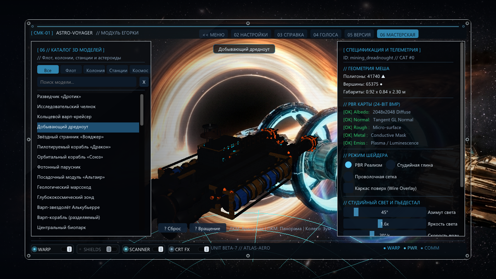<br>
      <b>Mining Dreadnought (4) (41 740 tris)</b><br>
      <sub>Режим PBR: роторная дробилка, лазерные стрелы, канистры гелия-3 и термоядерные сопла</sub>
    </td>
  </tr>
  <tr>
    <td width="50%" align="center">
      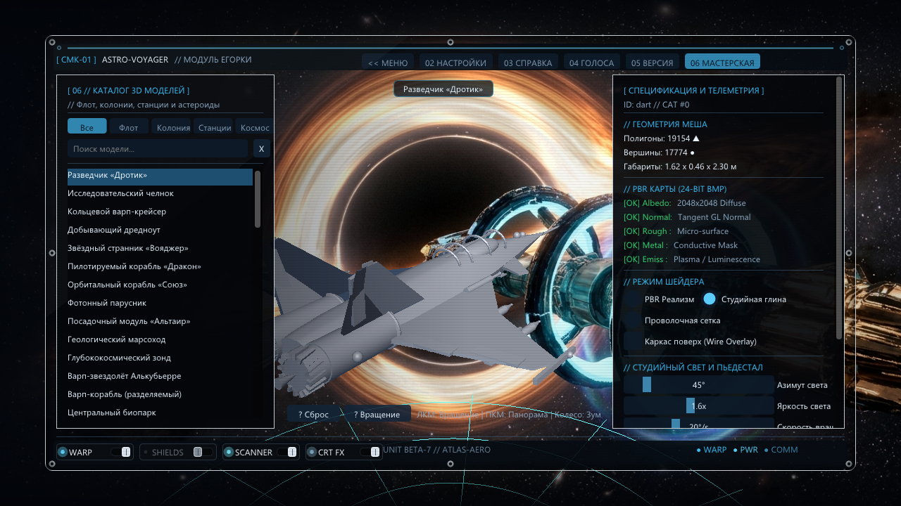<br>
      <b>Скоростной перехватчик Dart (Studio Clay, 19 220 tris)</b><br>
      <sub>Режим «Студийная глина»: проверка топологии, фасок фюзеляжа, сопел CTV и пилонов вооружения</sub>
    </td>
    <td width="50%" align="center">
      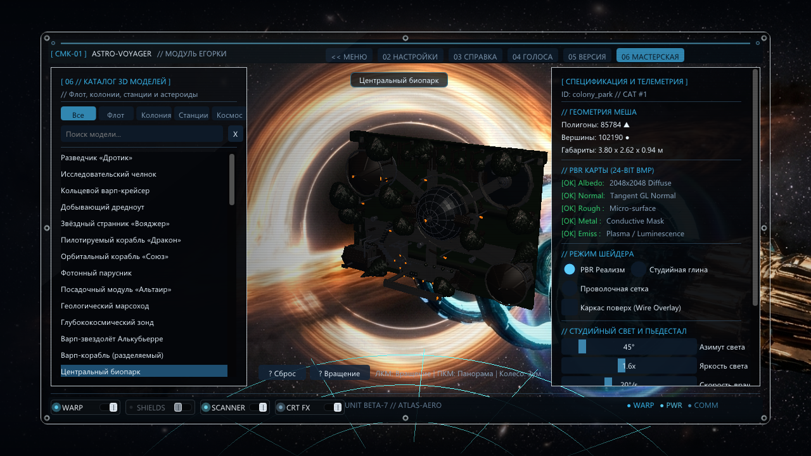<br>
      <b>Парк колонии с геодезическим куполом (85 784 tris)</b><br>
      <sub>Режим PBR: оранжерея замкнутой биосферы, кольцевая балка, аллеи и ротонда</sub>
    </td>
  </tr>
  <tr>
    <td width="50%" align="center">
      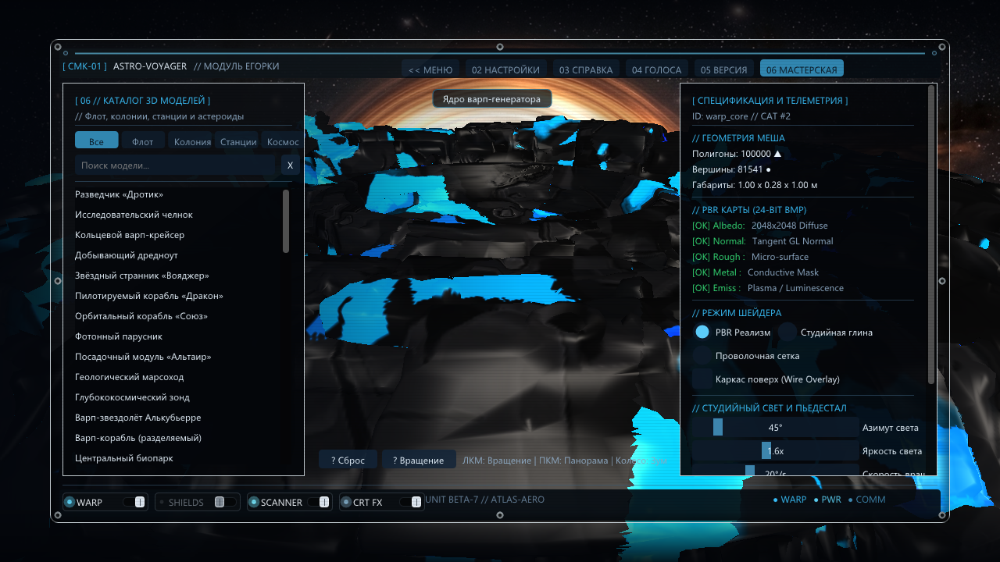<br>
      <b>Квантовый варп-генератор / ядро (80 000 tris)</b><br>
      <sub>Режим PBR: центральная плазменная квантовая линза (#00D4FF), фазовые волноводы и титановые кожухи</sub>
    </td>
    <td width="50%" align="center">
      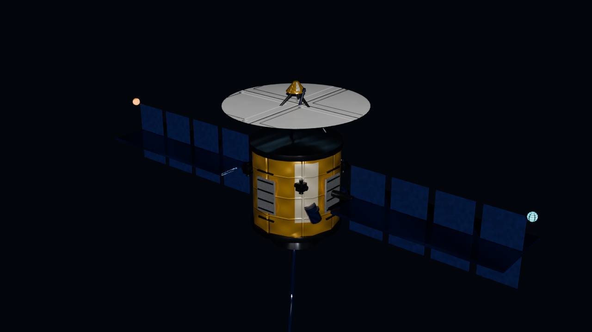<br>
      <b>Зонд дальнего космоса Deep Space Probe v2 (16 838 tris)</b><br>
      <sub>Режим PBR: 12-гранный отсек с ЭВТИ, 3.5м Cassegrain-антенна, солнечные панели, РИТЭГ и РКС</sub>
    </td>
  </tr>
</table>

---

## 🚀 Управляемый флот и корабли / Fleet Showcase

Каждый корабль снабжён индивидуальной динамикой, физикой инерции и полным комплектом 2K PBR-текстур (albedo, normal, rough, metal, emissive):

<table>
  <tr>
    <td width="50%" align="center">
      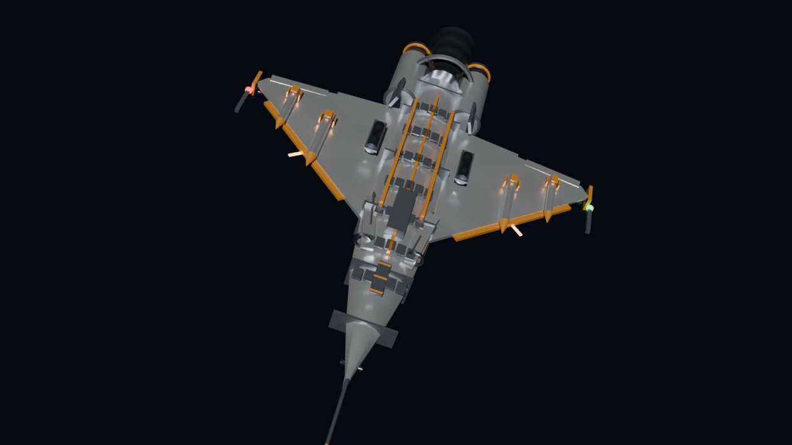<br>
      <b>Скоростной перехватчик: Dart (Стиль 0, 19 220 tris)</b><br>
      <sub>Клиновидный фюзеляж, стреловидное дельта-крыло, сопла с вектором тяги (CTV), форсаж на обычном топливе (<code>Left Shift</code>)</sub>
    </td>
    <td width="50%" align="center">
      <br>
      <b>Тяжёлый эксплорер: Shuttle (Стиль 2, 25 144 tris)</b><br>
      <sub>Несущий корпус, теплозащитные плитки (TPS), панорамная рубка, маршевые сопла, мотогондолы и грузовой отсек</sub>
    </td>
  </tr>
  <tr>
    <td width="50%" align="center">
      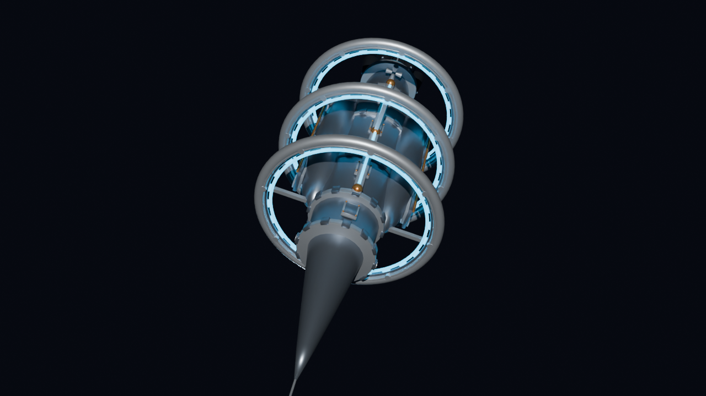<br>
      <b>Крейсер Алькубьерре: Ring Ship (Стиль 1, 36 354 tris)</b><br>
      <sub>Три независимых кольца Алькубьерре с 20 хомутами катушек и квантовыми инжекторами, продольная ферма, навигационные стробоскопы</sub>
    </td>
    <td width="50%" align="center">
      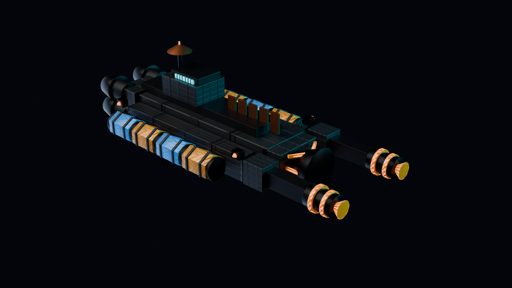<br>
      <b>Тяжёлый транспорт: Mining Dreadnought (4) (Стиль 4, 41 740 tris)</b><br>
      <sub>Индустриальный исполин: роторная дробилка с 24 шипами, лазерные стрелы, канистры гелия-3, 4 термоядерных сопла, варп-привод</sub>
    </td>
  </tr>
  <tr>
    <td width="50%" align="center">
      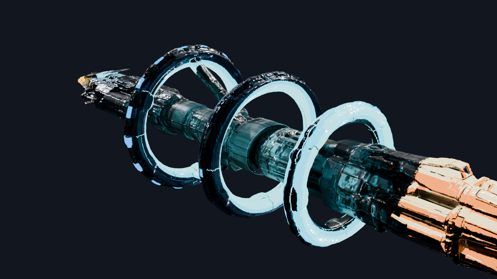<br>
      <b>Флагман дальнего поиска: Warp Cruiser (Стиль 3, 224 400 tris)</b><br>
      <sub>Классический двухгондольный крейсер: коллекторы Буссара, носовой дефлектор, квантовые шины и полный навигационный комплекс</sub>
    </td>
    <td width="50%" align="center">
      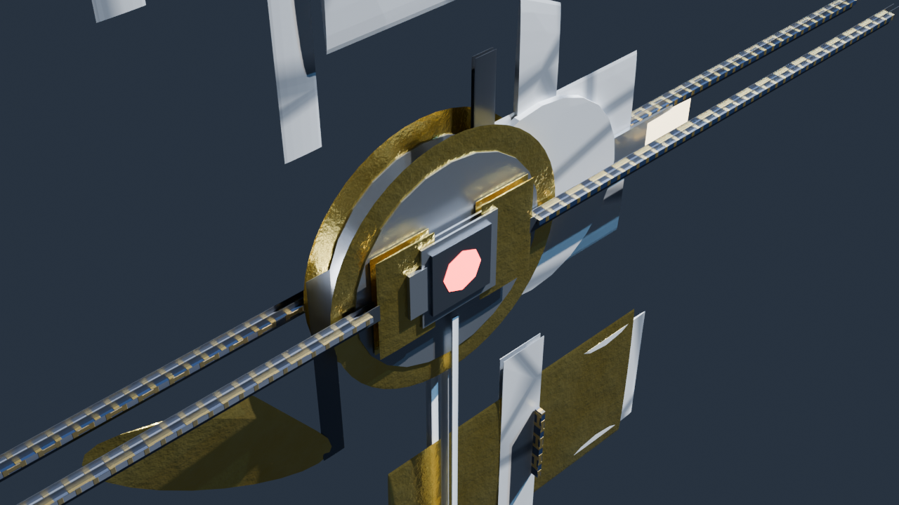<br>
      <b>Модульная космическая станция МКС (International Space Station)</b><br>
      <sub>Интегрированная ферма ITS, модули USOS/ROS, вращающаяся центрифуга гравитации и поворотные фотоэлектрические панели SARJ</sub>
    </td>
  </tr>
</table>

---

## 🛰️ Геометрии искривления пространства-времени и гиперврата

3D-модели математических решений уравнений общей теории относительности и метрики Алькубьерре:

<table>
  <tr>
    <td width="33%" align="center">
      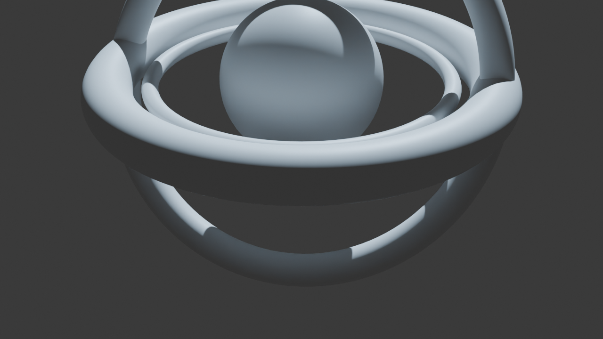<br>
      <b>Варп-пузырь Алькубьерре (30 736 tris)</b><br>
      <sub>Геодезическая сфера 96×48, двойные торы 128×32 и 12 квантовых эмиттеров поля</sub>
    </td>
    <td width="33%" align="center">
      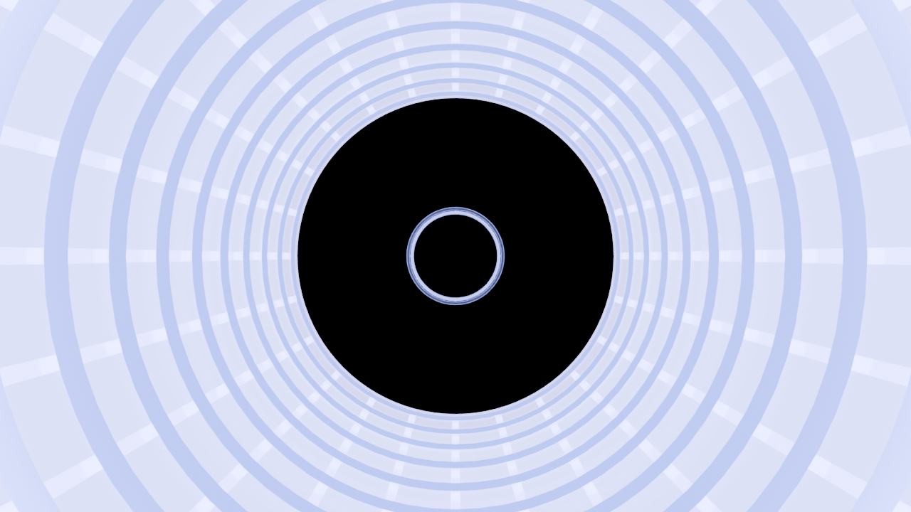<br>
      <b>Варп-туннель перехода (14 896 tris)</b><br>
      <sub>Радиальная труба 128×32, 16 шпангоутов, 24 рельса и внешняя плазменная оболочка</sub>
    </td>
    <td width="33%" align="center">
      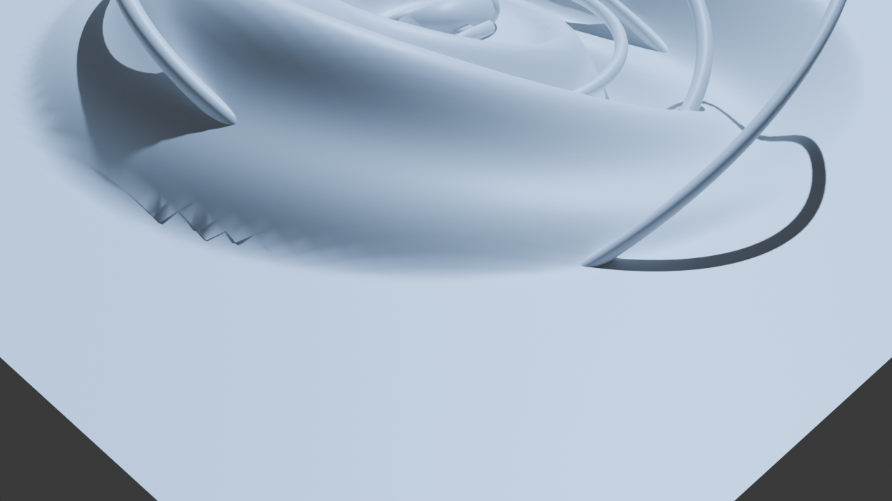<br>
      <b>Визуализатор варп-метрики (45 868 tris)</b><br>
      <sub>Сетка тензора пространства-времени 100×100 и 4 кольцевых проектора 128×24</sub>
    </td>
  </tr>
</table>

---

## ☄️ Пояс астероидов и архитектура колоний / Celestial & Colonies

<p align="center">
  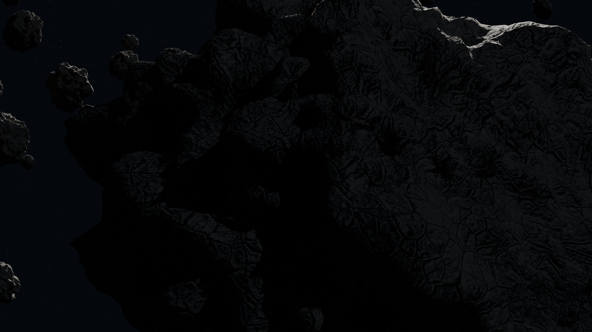
  <br>
  <sub><b>Пояс астероидов (20 480 tris на каждый тип)</b>: углистый хондрит (Тип-C), каменный силикат (Тип-S) и металл (Тип-M) с 2K PBR-картами микрократеров и разломов реголита.</sub>
</p>

### Модули планетарных колоний (ColonySystem 2.0)
24 технологические стадии развития на 8 небесных телах с физическими бонусами ускорения варпа, емкости щитов и научных очков:

<table>
  <tr>
    <td width="33%" align="center">
      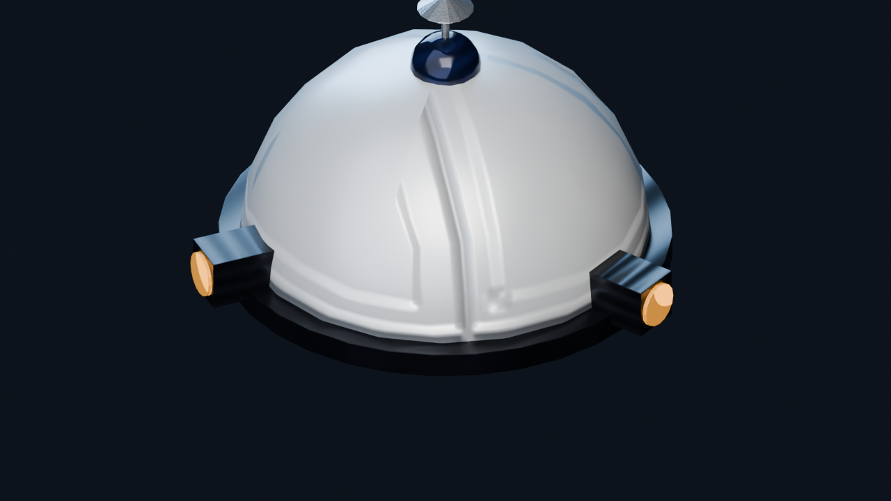<br>
      <b>Биосферный жилой купол (Dome)</b><br>
      <sub>Герметичный модуль с замкнутой биосферой и гидропонными оранжереями</sub>
    </td>
    <td width="33%" align="center">
      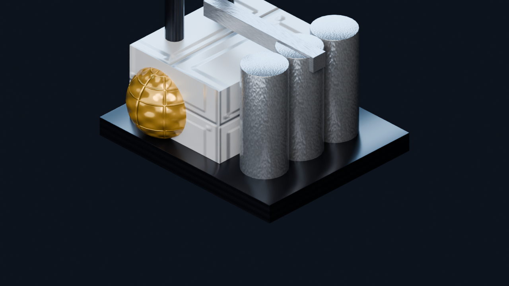<br>
      <b>Промышленный перерабатывающий завод</b><br>
      <sub>Добыча и обогащение руд реголита, синтез композитов и 3D-печать модулей</sub>
    </td>
    <td width="33%" align="center">
      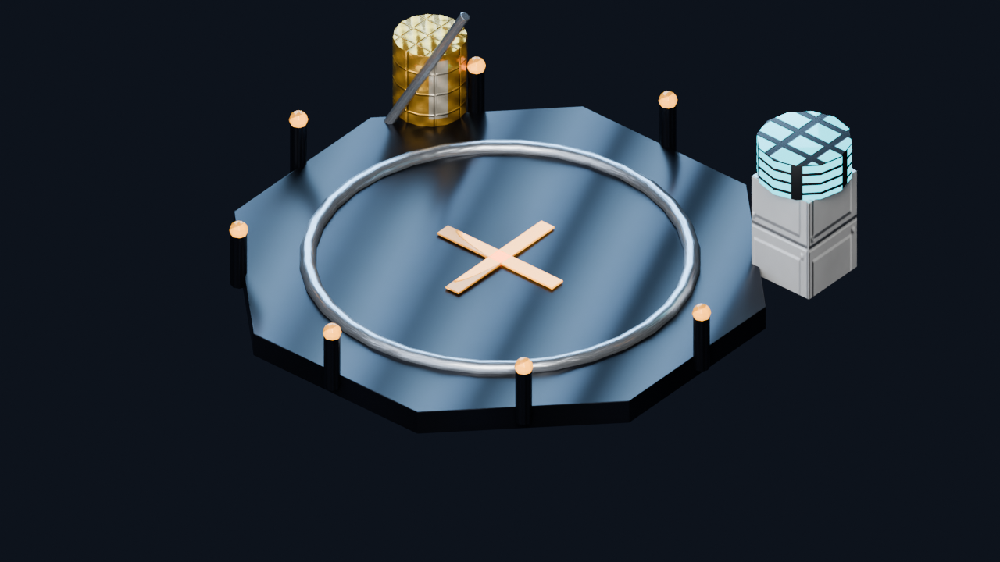<br>
      <b>Орбитально-посадочный космодром</b><br>
      <sub>Посадочная платформа с автоматической дозаправкой, ремонтом и логистикой</sub>
    </td>
  </tr>
</table>

---

## 🛰️ Реальная космонавтика и обсерватории (NASA & Spaceflight)

<table>
  <tr>
    <td width="50%" align="center">
      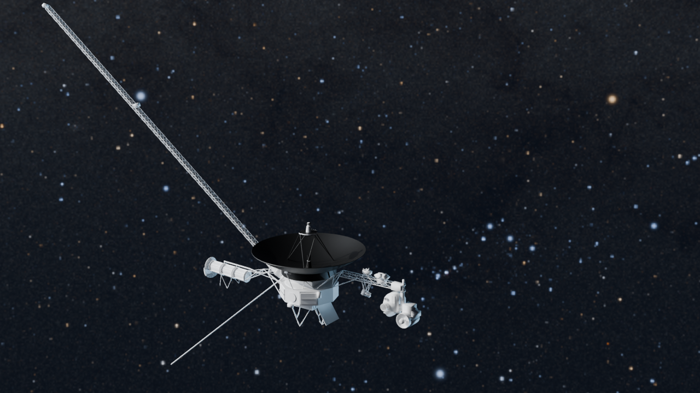<br>
      <b>Межзвёздный зонд «Вояджер-1»</b><br>
      <sub>Золотая пластинка, 3.7м антенна и штанги магнитометров (NASA 3D Resources / Public Domain)</sub>
    </td>
    <td width="50%" align="center">
      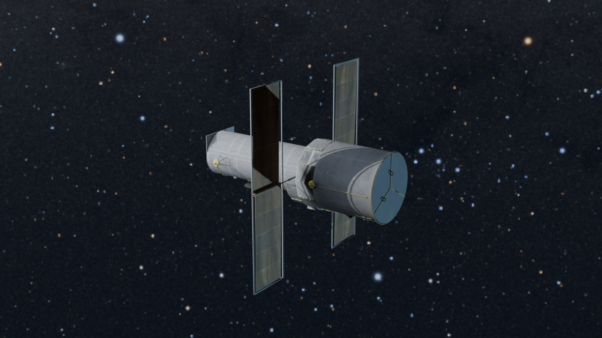<br>
      <b>Космический телескоп «Хаббл»</b><br>
      <sub>Орбитальная обсерватория с защитной блендой и солнечными батареями</sub>
    </td>
  </tr>
  <tr>
    <td width="33%" align="center">
      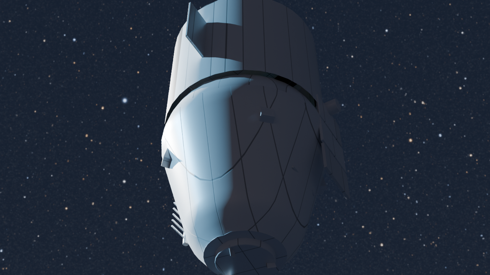<br>
      <b>SpaceX Crew Dragon</b><br>
      <sub>Пилотируемый корабль нового поколения, PBR-обшивка и носовой обтекатель</sub>
    </td>
    <td width="33%" align="center">
      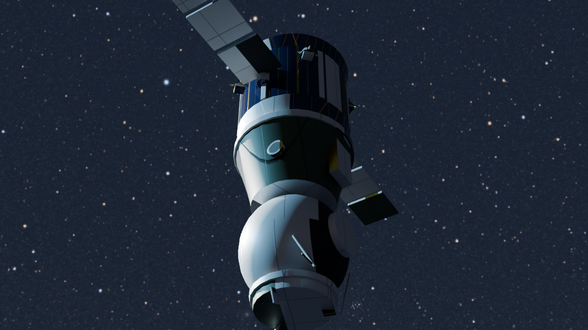<br>
      <b>Пилотируемый «Союз-МС»</b><br>
      <sub>Спускаемый аппарат, бытовой и приборно-агрегатный отсеки</sub>
    </td>
    <td width="33%" align="center">
      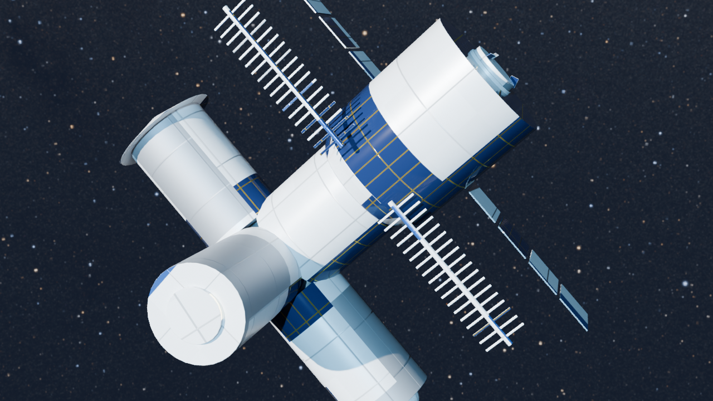<br>
      <b>Орбитальный комплекс «Мир»</b><br>
      <sub>Исторический многомодульный орбитальный комплекс («Квант», «Кристалл», «Спектр»)</sub>
    </td>
  </tr>
</table>

---

## 💺 Диегетический 3D-кокпит и Zero-UI HUD

<table>
  <tr>
    <td width="50%" align="center">
      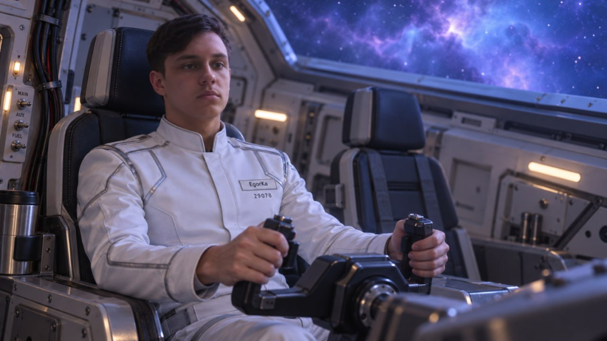<br>
      <b>Диегетический 3D-кокпит пилота</b><br>
      <sub>Коллиматорный ИЛС на бесконечности, MFD/PFD-дисплеи, расчёт перегрузок $G$-load, блэкаут/редаут и плазменный кокон</sub>
    </td>
    <td width="50%" align="center">
      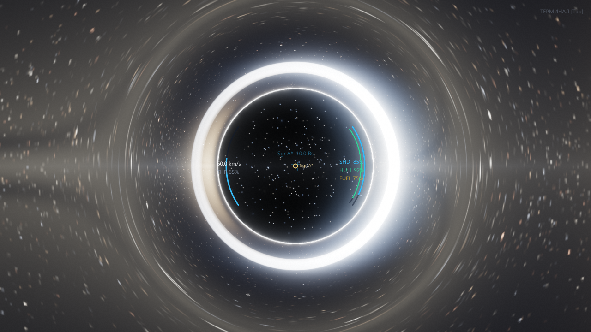<br>
      <b>Кинематографичный Zero-UI Flight HUD</b><br>
      <sub>Полное отсутствие статических окон в полёте: микро-ретикл, адаптивные дуги вектора тяги и щитов с плавным альфа-затуханием</sub>
    </td>
  </tr>
</table>

---

## Управление / Controls

| Клавиша | Геймпад | Действие |
|---|---|---|
| **WASD** + мышь | **Левый стик** | Свободный полёт, тангаж и рыскание |
| **Left Shift** | **RT** | Форсажное ускорение маршевых двигателей (`[BOOST]`) |
| **X** / **[** **]** | **LB** / **RB** | Варп-привод (факторы 1–9) |
| **Tab** | **View / Back** | Единый бортовой терминал корабля (Ship OS) |
| **1** .. **5** | **D-Pad** | Вкладки терминала: Навигация, Второй Мозг, Наука, Верфь, Журнал |
| **E** | **Кнопка A** | Контекстное действие: Посадка / Взлёт / Стыковка (в Action Horizon) |
| **G** | **D-Pad Вверх** | Выпуск / уборка гидравлического шасси (`GEAR DOWN` / `GEAR UP`) |
| **F** | — | Бурение грунта и отбор керна на планете (+250 RP) |
| **C** | — | Астрофизический спектрометр: сканирование линий поглощения (+100 RP) |
| **M** | **D-Pad Вправо** | Голографическая 3D-Оррери Звёздная карта |
| **B** | **Кнопка Y** | Astro-Zettelkasten («Второй Мозг»): граф мыслей и синтез |
| **K** | **Кнопка X** | Кодекс открытий (в полёте) / Верфь кастомизации (в доке) |
| **U** | — | Свернуть / развернуть панель квестов в HUD |
| **V** | — | Переключение камеры: кокпит (1-е лицо) / внешний вид (3-е лицо) |
| **F8** | — | Фоторежим (Photo Mode): свободная орбитальная камера без интерфейса |
| **Esc** | **Start / Menu** | Главное меню / Пауза / Назад |

---

## Сборка из исходников / Building from Source

### Сборка 3D-приложения (OpenGL 3.3 Core)
```bash
cmake -S . -B build-gl -DASTROVOYAGER_ENABLE_GL=ON -DCMAKE_BUILD_TYPE=Release
cmake --build build-gl --config Release
./build-gl/Release/astro-voyager.exe --gl
```

### Сборка headless core (физические тесты и CLI)
```bash
cmake -S . -B build -DCMAKE_BUILD_TYPE=Release
cmake --build build --config Release
./build/astro-voyager --demo-kerr
./build/astro-voyager --demo-warp
```

### Тестирование
```powershell
powershell -ExecutionPolicy Bypass -File tests/test_static_checks.ps1
ctest --test-dir build-gl -C Release
```

---

## Атрибуция / Attribution & Licenses

- **SpaceX Crew Dragon 2 exterior** — Jon Ross ([zlsa](https://sketchfab.com/zlsa)), лицензия [CC BY 4.0](https://creativecommons.org/licenses/by/4.0/).
- **Mir Station with Soyuz and Progress docked** — [tashtego](https://sketchfab.com/tashtego), лицензия [CC BY-NC 4.0](https://creativecommons.org/licenses/by-nc/4.0/).
- **NASA 3D Resources** — модели Voyager, Hubble, Parker Solar Probe, ISS в общественном достоянии (Public Domain).
- Подробные спецификации и лицензии сторонних ресурсов приведены в [`docs/SPACECRAFT_ASSETS.md`](docs/SPACECRAFT_ASSETS.md) и [`docs/NASA_ASSETS.md`](docs/NASA_ASSETS.md).
- Исходный код симулятора распространяется под лицензией [MIT](LICENSE).
