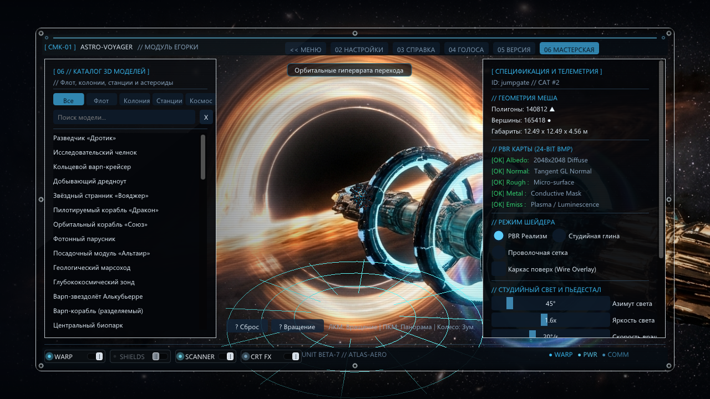
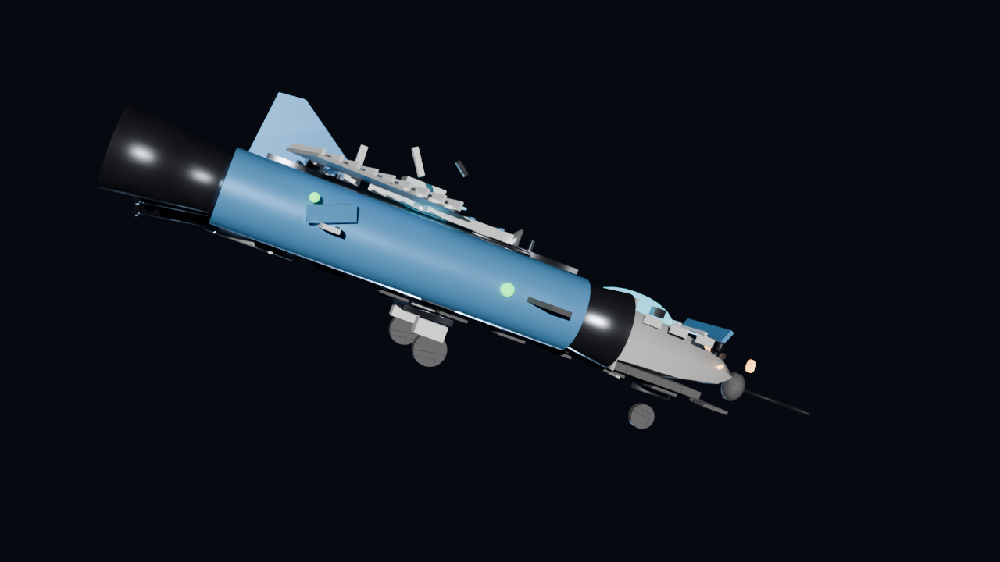

# astro-voyager

[](https://github.com/remageht/astro-voyager/actions/workflows/build.yml)
[](https://github.com/remageht/astro-voyager/releases)


Физически корректный 3D-симулятор Вселенной на **C++17** и **OpenGL 3.3 Core**. Включает релятивистские черные дыры с численным RK4-линзированием в реальном времени, сверхсветовой варп-привод Алькубьерре, орбитальные гиперврата перехода, интерактивную 3D Мастерскую с каталогом из 58 AAA-моделей, 24-этапную колонизацию миров и кинематографичный диегетический кокпит с Zero-UI.


*Сверхмассивная чёрная дыра Sgr A*: численное RK4-линзирование в метрике Шварцшильда, фотонное кольцо и аккреционный диск Новикова-Торна с релятивистским доплеровским бимингом.*

---

## Скачать и играть / Download & Play

Готовые автономные сборки (не требуют установки и зависимостей):
- 🎮 **Windows (x86_64)**: [astro-voyager-v5.0.0-windows-x86_64-portable.zip](https://github.com/remageht/astro-voyager/releases/latest) (портативный архив со всеми 3D-моделями, текстурами и аудио).
- 🐧 **Linux (x86_64)**: [astro-voyager-x86_64.AppImage](https://github.com/remageht/astro-voyager/releases/latest) (`chmod +x *.AppImage && ./*.AppImage`) или `tar.gz` портативный архив.
- 🍏 **macOS (Apple Silicon arm64)**: [astro-voyager-macos-arm64.tar.gz](https://github.com/remageht/astro-voyager/releases/latest) (нативная сборка OpenGL 3.3 Core).

*Требования*: Видеокарта с поддержкой OpenGL 3.3 Core Profile (Intel HD 4000+, NVIDIA GTX 600+, AMD HD 7000+).

### Диагностика и устранение неполадок
- `astro-voyager.exe --diagnostics` — выводит информацию о GPU, версии OpenGL и драйвере.
- `astro-voyager.exe --safe` — безопасный режим с уменьшенным числом шагов маршинга и отключенным FXAA.
- Лог запуска автоматически пишется в `astro-voyager.log` рядом с исполняемым файлом.

---

## Ключевые особенности / Features

- 🌟 **Интерактивная 3D Мастерская (3D Model Workshop)**: каталог из 58 высокополигональных моделей (от 11k до 224k полигонов) с 2K PBR-картами (albedo, normal, rough, metal, emissive). Режимы Cook-Torrance GGX и Studio Clay, свободная орбитальная камера, координатная сетка и инженерная телеметрия габаритов.
- 🌌 **Релятивистская астрофизика**: численная RK4-трассировка нулевых геодезических в метриках Шварцшильда и Керра, аккреционные диски Новикова-Торна, прецессия двойных черных дыр (OJ 287), гравитационное красное смещение и доплеровский биминг.
- ⚡ **Варп-привод Алькубьерре и гиперврата**: 3+1 ADM-метрика искривления пространства-времени, варп-пузырь с $\sigma$-стенкой, 1–9 варп-факторы и циклопические гиперврата Jumpgate для перехода между Солнечной системой и Sgr A*.
- 🏙️ **Колонизация миров (ColonySystem 2.0)**: 24 технологические стадии развития на 8 небесных телах (купола, заводы, космодромы, АЭС, ЛЭП, дата-центры, терраформирование и внутриигровые перки ускорения варпа и щитов).
- 💺 **Диегетический 3D-кокпит и Zero-UI**: коллиматорный ИЛС на бесконечности, MFD/PFD-приборы, расчет перегрузок $G$-load с эффектами блэкаута/редаута, ионизационный плазменный кокон в атмосфере и адаптивные дуги вектора тяги.
- 🎮 **Полная поддержка геймпадов и Steam Deck**: аналоговое управление тягой и тангажем с радиальной мертвой зоной, контекстные глифы подсказок и навигация по бортовому терминалу (`Tab`).
- 🧠 **Astro-Zettelkasten («Второй Мозг»)**: динамический граф знаний и гипотез с вики-ссылками `[[...]]`, синтезом Эврики и экспортом в Obsidian.

---

## 3D Мастерская и Флот кораблей / Fleet Showcase

<table>
  <tr>
    <td width="50%" align="center">
      <br>
      <b>Орбитальные гиперврата Jumpgate (140k tris)</b><br>
      <sub>8 плазменных эмиттеров, апертура 7.5м, квантовый переход Sol ↔ Sgr A*</sub>
    </td>
    <td width="50%" align="center">
      <br>
      <b>Mining Dreadnought (4) (41.7k tris)</b><br>
      <sub>Тяжёлый шахтёрский дредноут: роторная дробилка, лазерные стрелы и термоядерные сопла</sub>
    </td>
  </tr>
  <tr>
    <td width="50%" align="center">
      <br>
      <b>Скоростной перехватчик Dart (19.2k tris)</b><br>
      <sub>Клиновидный корпус, сопла с вектором тяги CTV и форсаж на обычном топливе</sub>
    </td>
    <td width="50%" align="center">
      <br>
      <b>Тяжёлый эксплорер Shuttle (25.1k tris)</b><br>
      <sub>Несущий корпус, теплозащитные плитки TPS, панорамная рубка и грузовой отсек</sub>
    </td>
  </tr>
</table>

В ангаре верфи доступны 5 управляемых стилей: скоростной **Dart** (0), три-кольцевой крейсер **Ring Ship** (1), исследовательский **Shuttle** (2), флагман **Warp Cruiser** (3, 224k tris) и индустриальный исполин **Mining Dreadnought (4)**.

---

## Управление / Controls

| Клавиша | Геймпад | Действие |
|---|---|---|
| **WASD** + мышь | **Левый стик** | Свободный полет, тангаж и рыскание |
| **Left Shift** | **RT** | Форсажное ускорение маршевых двигателей (`[BOOST]`) |
| **X** / **[** **]** | **LB** / **RB** | Варп-привод (факторы 1–9) |
| **Tab** | **View / Back** | Единый бортовой терминал корабля (Ship OS) |
| **1** .. **5** | **D-Pad** | Вкладки терминала: Навигация, Второй Мозг, Наука, Верфь, Журнал |
| **E** | **Кнопка A** | Контекстное действие: Посадка / Взлет / Стыковка (в Action Horizon) |
| **G** | **D-Pad Вверх** | Выпуск / уборка гидравлического шасси (`GEAR DOWN` / `GEAR UP`) |
| **F** | — | Бурение грунта и отбор керна на планете (+250 RP) |
| **C** | — | Астрофизический спектрометр: сканирование линий поглощения (+100 RP) |
| **M** | **D-Pad Вправо** | Голографическая 3D-Оррери Звёздная карта |
| **B** | **Кнопка Y** | Astro-Zettelkasten («Второй Мозг»): граф мыслей и синтез |
| **K** | **Кнопка X** | Кодекс открытий (в полете) / Верфь кастомизации (в доке) |
| **U** | — | Свернуть / развернуть панель квестов в HUD |
| **V** | — | Переключение камеры: кокпит (1-е лицо) / внешний вид (3-е лицо) |
| **F8** | — | Фоторежим (Photo Mode): свободная орбитальная камера без интерфейса |
| **Esc** | **Start / Menu** | Главное меню / Пауза / Назад |

---

## Сборка из исходников / Building from Source

### Сборка 3D-приложения (OpenGL 3.3 Core)
```bash
cmake -S . -B build-gl -DASTROVOYAGER_ENABLE_GL=ON -DCMAKE_BUILD_TYPE=Release
cmake --build build-gl --config Release
./build-gl/Release/astro-voyager.exe --gl
```

### Сборка headless core (физические тесты и CLI)
```bash
cmake -S . -B build -DCMAKE_BUILD_TYPE=Release
cmake --build build --config Release
./build/astro-voyager --demo-kerr
./build/astro-voyager --demo-warp
```

### Тестирование
```powershell
powershell -ExecutionPolicy Bypass -File tests/test_static_checks.ps1
ctest --test-dir build-gl -C Release
```

---

## Атрибуция / Attribution & Licenses

- **SpaceX Crew Dragon 2 exterior** — Jon Ross ([zlsa](https://sketchfab.com/zlsa)), лицензия [CC BY 4.0](https://creativecommons.org/licenses/by/4.0/).
- **Mir Station with Soyuz and Progress docked** — [tashtego](https://sketchfab.com/tashtego), лицензия [CC BY-NC 4.0](https://creativecommons.org/licenses/by-nc/4.0/).
- **NASA 3D Resources** — модели Voyager, Hubble, Parker Solar Probe, ISS в общественном достоянии (Public Domain).
- Подробные спецификации и лицензии сторонних ресурсов приведены в [`docs/SPACECRAFT_ASSETS.md`](docs/SPACECRAFT_ASSETS.md) и [`docs/NASA_ASSETS.md`](docs/NASA_ASSETS.md).
- Исходный код симулятора распространяется под лицензией [MIT](LICENSE).
