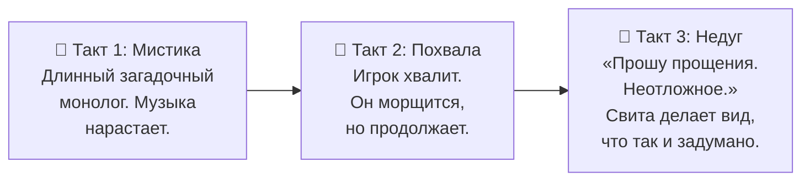

# CODEX: Мистик Пятой — v1.1

> *Патч 1.1 — «Мистика, слабости и один деликатный недуг»*

---

## Суть персонажа

Он загадочен настолько, что это уже не характер, а стиль: полуфразы, паузы,
взгляд чуть мимо собеседника, отказ называть Кузьму по имени, фразы вроде
«я был там, где не было времени». Никто не знает, откуда он. Он сам, похоже, тоже.

> [!IMPORTANT]
> **Главный фокус:** его загадочность — **не глубина, а защитный механизм**.
> Каждая мистическая фраза — уклонение от конкретного вопроса.
> Он говорит загадками не потому, что знает тайну. Он говорит загадками потому,
> что **не хочет отвечать**.

---

## Слабости

### 1. Похвала

Любой комплимент вызывает внезапную мигрень: в висках стучит, полное имя
рассыпается на куски, в глазах двоится. Чем искреннее похвала — тем сильнее
приступ.

**Официальное объяснение:** *«Похвала родом из Четвёртой. Организм отторгает.»*

### 2. Недуг Пятой

Хроническое расстройство желудка неустановленной этиологии.

- В кодексе — «наследие Кузьмы».
- В народе — «Четвёртая болезнь».

Приступ случается в самый неподходящий момент: перед парадом, посреди речи,
на дуэли. Он называет это «дипломатическим перерывом» и крайне злится, если
кто-то улыбнётся.

### 3. Прямой вопрос

Физически не способен ответить прямо. Даже когда хочет. Особенно когда хочет.

---

## Правило утечки

Когда у него мигрень от похвалы — на несколько секунд он говорит **прямо**.
Это единственное окно правды во всей игре.

- Игрок, который научится его хвалить — получит сюжет.
- Игрок, который будет хвалить слишком часто — получит приступ и потеряет ход.

---

## Механика

| Действие игрока | Эффект |
|---|---|
| **Похвалить** (без ошибки в имени) | +1 стак мигрени. На 3 стаках — «Приступ»: теряет ход, выдаёт одну правдивую реплику из скрытого пула |
| **Польстить** (с ошибкой в титуле или упоминанием Пятой) | −1 стак мигрени, +высокомерие, он баффается. *«Вот. Хоть кто-то понимает.»* |
| **Давить** (3 неудачных вопроса подряд) | Триггер «Недуга Пятой»: уходит на 1 ход, возвращается злее и с сухим *«Прошу прощения. Протокол»* |
| **Спросить прямо** | Он отвечает загадкой. Всегда. Даже если ответ очевиден |

---

## Реплики

### При похвале (мигрень нарастает)

| ID | Текст |
|---|---|
| `praise_01` | *«Не надо. Не... не надо комплиментов. Я от них... умираю. В смысле — в Четвёртой.»* |
| `praise_02` | *«Тише. Тише. Ты не понимаешь, что делаешь.»* |
| `praise_03` | *«Ещё одно доброе слово, и я буду вынужден... прости, у меня... в висках...»* |

### При приступе мигрени (утечка правды)

> [!CAUTION]
> Эти реплики скрыты от игрока до момента приступа. Это ядро сюжета.

| ID | Текст |
|---|---|
| `truth_01` | *«Кузьма... не существует. Я его... придумал. В четвёртом... году.»* |
| `truth_02` | *«Я не из Пятой. Я из... из очереди. Четвёртой.»* |
| `truth_03` | *«Мне... страшно. Не говори никому. Особенно Совету.»* |

### При «Недуге Пятой» (уходит)

| ID | Текст | Условие |
|---|---|---|
| `ailment_01` | *«Прошу прощения. Неотложное. Протокол.»* | — |
| `ailment_02` | *«Это не болезнь. Это наследие Кузьмы.»* | — |
| `ailment_03` | *«Ничего не произошло. Парад продолжается. Я вернусь.»* | — |
| `ailment_04` | *«Смешно? Смешно. Запомнил.»* | Игрок засмеялся |

### Мистические (ответ на любой прямой вопрос)

| ID | Текст |
|---|---|
| `mystic_01` | *«Я был там, где не было времени. Там тоже был я.»* |
| `mystic_02` | *«Пятая Вселенная не начинается и не кончается. Она просто... очередь.»* |
| `mystic_03` | *«Ты спрашиваешь, откуда я. Я отвечу: оттуда же, откуда ты. Просто раньше.»* |
| `mystic_04` | *«Кузьму не называют по имени. Кузьма — это состояние.»* |

---

## Ритм сцены (три такта)

> [!TIP]
> На третьем такте игрок должен понять: **его можно победить вежливостью**.
> Не силой, не хитростью — комплиментом. Это и есть главный прикол персонажа.

---

## Связь с данными

Машиночитаемый кодекс с ID реплик, стаками и триггерами:
[codex_mystic.json](file:///c:/Users/Эмир/Documents/Default%20Project/astro-voyager/res/story/codex_mystic.json)

Формат совместим с `res/catalog.json` / `res/constellations.json` —
загружается в рантайме без перекомпиляции.

---

## Степень явности «Недуга Пятой»

Сейчас — в эвфемизмах (*«дипломатический перерыв»*, *«наследие Кузьмы»*,
*«Протокол»*). Если рейтинг позволяет — можно сделать прямее:
добавить звуковые эффекты, анимацию, реплики свиты.

**Решение за владельцем.**
